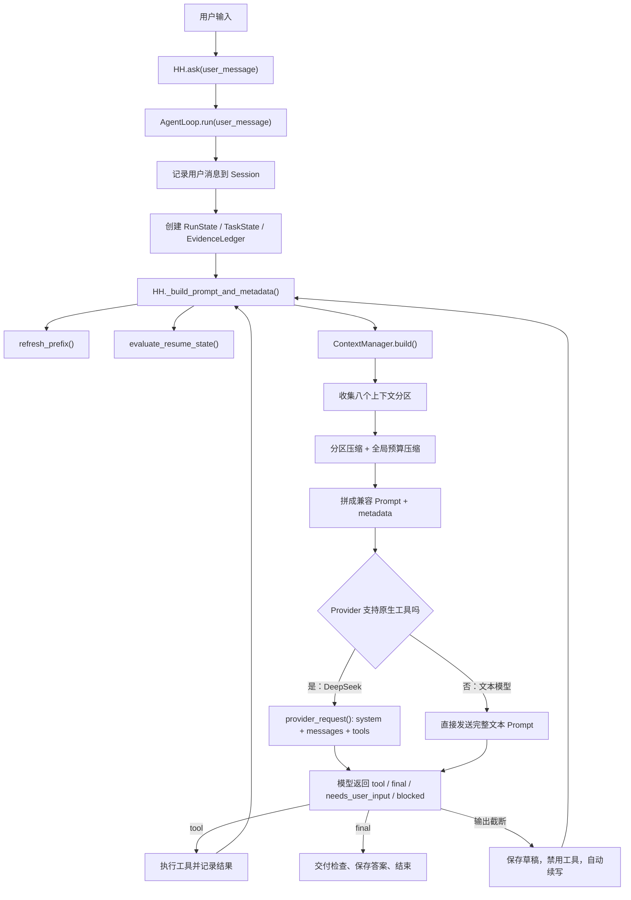

# HH Agent Pro 上下文工程与 Prompt 工程：从零基础到能独立讲解

> 本文对应当前项目中的真实实现，主要涉及：
>
> - `hh_agent_pro/agent_loop.py`
> - `hh_agent_pro/runtime.py`
> - `hh_agent_pro/context_manager.py`
> - `hh_agent_pro/prompt_prefix.py`
> - `hh_agent_pro/features/memory.py`
> - `hh_agent_pro/evidence.py`
> - `hh_agent_pro/checkpoint.py`
> - `hh_agent_pro/providers/clients.py`
>
> 目标不是让你背代码，而是让你理解：为什么需要这些模块、数据怎样流动、
> 每个函数替下一个函数解决了什么问题，以及面试时怎样把设计讲清楚。

---

## 1. 先用一句话说清整个设计

HH Agent Pro 的上下文系统不是简单地把全部聊天记录发给大模型，而是：

> 把磁盘里保存的完整事实，按照“规则、当前任务、工作记忆、源码证据、相关旧记忆、
> 对话历史、当前问题”等职责重新整理成一份有预算、有优先级、可追踪的临时材料包，
> 再根据不同模型接口把材料包转换成正确的 Prompt 或角色消息。

这里有三个非常重要的词：

1. **完整保存**：Session 中已经记录的事件不会因为 Prompt 压缩而被删除；单次巨大
   工具输出仍可能在进入 Session 前按工具安全上限裁剪。
2. **选择性注入**：每次只给模型看当前真正有用的部分。
3. **可解释压缩**：系统会记录哪一段从多长压到了多长，而不是悄悄切掉文本。

如果你现在只能记住一句话，就记住上面这一句。

---

## 2. 完全不懂 AI 和 Python，也能理解的比喻

### 2.1 大模型像一个临时来上班的工程师

每调用一次大模型，都可以想象成请来了一位能力很强、但刚走进办公室的工程师。
他不会天然知道：

- 这是哪个项目；
- 用户之前说过什么；
- 刚才读过哪些文件；
- 哪些任务已经完成；
- 哪个工具可以调用；
- 当前是否还能继续调用工具。

程序必须把这些信息整理好，再交给他。这份“上班材料”就是**上下文**。

### 2.2 上下文窗口像一个容量有限的行李箱

大模型一次能看的文字有上限。即使模型支持很长的上下文，也不能无限塞，因为：

- 输入越长，调用越贵；
- 模型越容易被旧信息干扰；
- 重复的工具输出会挤掉真正重要的信息；
- 大段源码里通常只有少数结构事实与当前问题有关。

所以我们不是把整个仓库和全部聊天记录倒进行李箱，而是先分类，再决定每类物品
能占多少空间。

### 2.3 Session 像档案室，Prompt 像今天带进会议室的文件夹

这是全文最容易混淆、也最重要的区别：

| 名称 | 比喻 | 作用 |
|---|---|---|
| Session history | 档案室 | 保存完整事件，便于恢复和复盘 |
| Working memory | 桌面便签 | 提醒当前任务、最近文件和短摘要 |
| Evidence Ledger | 已核验的源码卡片 | 保存读过的文件结构与新鲜度 |
| Checkpoint | 任务书签 | 保存目标、阻塞、下一步和关键文件 |
| Prompt/context | 本次会议文件夹 | 只装这一轮模型决策需要看的材料 |

**压缩 Prompt 不等于删除 Session。** 这里的“完整事件流”指角色、工具名、参数、
结果状态与可供后续模型使用的结果正文都按顺序存在；它不承诺无限保存任意大的终端
原始字节流，巨大结果可能先经过工具层的安全裁剪。

就像你不会把档案室所有文件都搬进会议室，但没有搬进去的档案依然存在。

---

## 3. 阅读代码前，先认识几个最基本的 Python 写法

本文会反复出现下面这些形式。即使你没学过 Python，也只需要先理解它们的直觉。

### 3.1 字典：一组“名称 → 内容”

```python
budgets = {
    "prefix": 5200,
    "history": 7200,
}
```

可以把它理解成一张表：`prefix` 的额度是 5200，`history` 的额度是 7200。

读取时写：

```python
history_budget = budgets["history"]
```

### 3.2 列表：有顺序的一串内容

```python
SECTION_ORDER = (
    "prefix",
    "working_memory",
    "history",
    "current_request",
)
```

它表示拼接顺序。位置在前的先出现，位置在后的后出现。

### 3.3 函数：给输入，做一件事，返回结果

```python
def build(user_message):
    prompt = "Current request: " + user_message
    return prompt
```

`def` 表示定义函数，`user_message` 是输入，`return` 是输出。

### 3.4 类与 `self`

```python
class ContextManager:
    def __init__(self, agent):
        self.agent = agent
```

`class` 可以理解成一种对象的设计图。`self` 表示“当前这个对象自己”。

`self.agent = agent` 的意思是：把传进来的 Agent 保存到当前 ContextManager 身上，
以后其他函数可以通过 `self.agent` 找到它。

### 3.5 `getattr` 与 `get`

```python
prefix = getattr(agent, "prefix", "")
history = session.get("history", [])
```

它们都在表达：“尝试取一个值，如果没有，就用安全的默认值。”

- `getattr` 常用于对象；
- `.get()` 常用于字典。

这样旧 Session 缺少新字段时，程序不容易直接崩溃。

---

## 4. 先看全景：一条用户请求到底经过哪些函数

假设用户输入：

```text
比较 memory 目录和 features/memory.py，判断是否应该合并。
```

完整调用链如下：



最外层入口非常简单：

```python
# hh_agent_pro/runtime.py
def ask(self, user_message):
    from .agent_loop import AgentLoop
    return AgentLoop(self).run(user_message)
```

逐行理解：

1. `ask()` 是其他模块调用 Agent 的统一入口。
2. 它没有自己处理 Prompt，也没有自己执行工具。
3. 它创建 `AgentLoop`，把控制权交给 `run()`。
4. `run()` 负责不断重复“组上下文 → 问模型 → 执行工具 → 再组上下文”。

这体现了一个重要设计思想：

> `HH` 是各组件的总装对象，`AgentLoop` 是流程导演，`ContextManager` 是材料编辑。

三者职责不要混在一起。

---

## 5. 上下文工程、Prompt 工程、记忆系统分别是什么

这三个概念经常被混用，先把边界说清楚。

### 5.1 记忆系统：信息存在哪里

它关心：

- 信息是否跨轮保存；
- 是否跨 Session 保存；
- 如何更新、删除和纠正；
- 文件摘要是否已经过期；
- 如何检索与当前问题有关的笔记。

### 5.2 上下文工程：这一轮应该给模型看什么

它关心：

- 哪些数据源应该参与本轮；
- 哪些内容优先级更高；
- 历史怎样摘要；
- 重复读取怎样折叠；
- 超出预算时先牺牲哪一层；
- 如何保证当前用户问题永远不被裁掉。

### 5.3 Prompt 工程：怎样把这些内容表达给模型

它关心：

- 系统规则怎样写；
- 工具格式怎样说明；
- section 怎样排序；
- DeepSeek 的 `system/user/assistant/tool` 角色怎样组织；
- final-only、截断恢复等运行时指令放在哪里；
- 模型输出必须遵守什么格式。

一句话总结：

> 记忆系统负责“仓库”，上下文工程负责“选材”，Prompt 工程负责“排版和说明”。

---

## 6. 为什么要拆成八个上下文分区

核心配置在 `hh_agent_pro/context_manager.py`：

```python
DEFAULT_TOTAL_BUDGET = 24000

DEFAULT_SECTION_BUDGETS = {
    "prefix": 5200,
    "working_memory": 850,
    "durable_memory": 500,
    "task_state": 950,
    "evidence": 5200,
    "relevant_memory": 700,
    "history": 7200,
}

SECTION_ORDER = (
    "prefix",
    "working_memory",
    "durable_memory",
    "task_state",
    "evidence",
    "relevant_memory",
    "history",
    "current_request",
)
```

注意：这些数字当前是**字符预算**，不是严格 token 数。

为什么先用字符？因为字符数：

- 不依赖某个模型的 tokenizer；
- 计算便宜；
- 多模型切换时行为稳定；
- 对本项目的学习型实现更容易解释和测试。

它不是最精确的 token 估算，但足够作为可靠的第一层控制。

### 6.1 八个分区分别负责什么

| 分区 | 放什么 | 为什么单独存在 |
|---|---|---|
| `prefix` | 身份、规则、工具规范、工作区快照 | 决定 Agent 能做什么、怎样做 |
| `working_memory` | 当前任务、最近文件、文件短摘要 | 提醒“手头正在做什么” |
| `durable_memory` | 用户偏好、项目约定、稳定事实 | 跨 Session 的长期背景 |
| `task_state` | 任务状态、子任务、阻塞、运行进度 | 控制是否真的可以交付 |
| `evidence` | 已读源码的结构摘要和新鲜度 | 防止历史压缩后丢失代码事实 |
| `relevant_memory` | 与当前问题最相关的最多三条笔记 | 按需召回，避免全部笔记常驻 |
| `history` | 用户、助手、工具事件的压缩回放 | 保持对话连续性 |
| `current_request` | 用户本轮原始请求及运行时指令 | 本轮最重要，永不裁剪 |

为什么不直接叫一个大 `memory`？

因为“用户喜欢中文回答”和“刚读了 `agent_loop.py`”都可以宽泛地叫记忆，但它们
的寿命、可信度、优先级和压缩方法完全不同。混成一段后，程序无法回答：

- 哪一类可以先删？
- 哪一类必须保留？
- 哪一类过期后应该失效？
- 哪一类只是控制状态，不能当作源码事实？

拆分以后，每一层都能有自己的规则。

---

## 7. 第一层 Prompt：稳定前缀是 Agent 的“工作手册”

### 7.1 前缀包含什么

`build_prompt_prefix()` 在 `hh_agent_pro/prompt_prefix.py` 中构造前缀。

核心结构可以简化为：

```python
def build_prompt_prefix(workspace, tools, runtime_info, native_tools=False):
    runtime_text = "\n".join(
        f"- {key}: {runtime_info.get(key, '')}"
        for key in (
            "provider", "model", "platform", "shell",
            "cwd", "repo_root", "approval_policy", "read_only"
        )
    )

    critical_text = f"""
    You are HH, a small local coding agent.

    Runtime identity:
    {runtime_text}

    Rules:
    - Use tools instead of guessing about the workspace.
    - Return one tool call, needs_user_input, blocked, or final.
    - Never invent tool results.

    Tools:
    {tool_text}
    """.strip()

    text = (
        critical_text
        + "\n\nWorkspace snapshot (compressible):\n"
        + workspace.text()
    )

    return PromptPrefix(
        text=text,
        hash=sha256(text),
        workspace_fingerprint=workspace.fingerprint(),
        tool_signature=tool_signature(tools),
    )
```

这里故意把前缀分成两部分：

```text
[不可随便压缩]
身份 + 行为规则 + 工具契约

Workspace snapshot (compressible):
[允许压缩]
Git 状态 + 项目文档摘要 + 最近提交
```

原因很直接：

- 工作区快照少看一些，模型可能少知道一个 Git 细节；
- 工具契约被切断，模型可能生成非法工具调用；
- 身份被切断，模型可能说错 provider、shell 或工作目录；
- 安全规则被切断，后果比少一个摘要严重得多。

所以压缩不能只写一个粗暴的 `text[:5200]`。

### 7.2 关键规则怎样受到保护

`ContextManager._render_prefix()`：

```python
def _render_prefix(raw, budget):
    marker = "\n\nWorkspace snapshot (compressible):\n"

    if marker not in raw:
        return _tail_clip(raw, budget)

    critical, workspace = raw.split(marker, 1)
    protected = critical + marker

    if budget <= len(protected):
        return protected

    return protected + _tail_clip(
        workspace,
        budget - len(protected),
    )
```

逐步解释：

1. 用 `marker` 找到可压缩区域的边界。
2. `critical` 是规则和工具契约。
3. `workspace` 是允许缩短的工作区快照。
4. 即使预算比规则本身还小，也宁可小幅超预算保留规则。
5. 只有剩余空间才分给工作区快照。

这是一种“**语义保护**”，不是普通字符串裁剪。

### 7.3 为什么前缀需要哈希

`PromptPrefix` 不只有文本，还有三个指纹：

```python
@dataclass
class PromptPrefix:
    text: str
    hash: str
    workspace_fingerprint: str
    tool_signature: str
    built_at: str
```

哈希可以理解成一段内容的“指纹”。只要内容变化，指纹通常就会变化。

- `hash`：整个 prefix 是否变化；
- `workspace_fingerprint`：工作区快照是否变化；
- `tool_signature`：工具名称、参数、风险或描述是否变化。

每轮都调用 `refresh_prefix()`，但不会无条件重建：

```python
def refresh_prefix(self, force=False):
    old_fingerprint = self.prefix_state.workspace_fingerprint
    new_workspace = WorkspaceContext.build(self.root)
    new_fingerprint = new_workspace.fingerprint()

    workspace_changed = force or new_fingerprint != old_fingerprint

    if workspace_changed:
        self.workspace = new_workspace
        prefix_state = self.build_prefix()
    else:
        prefix_state = self.prefix_state

    if force or prefix_state.hash != self.prefix_state.hash:
        self._apply_prefix_state(prefix_state)
```

设计目的：

- 工作区没变时，稳定前缀可以复用；
- 支持 Prompt cache 的 Provider 可以用前缀 hash 当缓存 key；
- Trace 能解释某轮 Prompt 为什么变化；
- 模型切换或工具清单变化时，又能强制刷新。

---

## 8. `ContextManager.build()`：上下文编辑部的总入口

`build()` 是上下文工程的中心函数。它返回两个结果：

```python
prompt, metadata = context_manager.build(user_message)
```

- `prompt`：真正准备发送的文本；
- `metadata`：这份 Prompt 怎样产生的审计说明。

### 8.1 第一步：收集原材料

真实代码的关键部分：

```python
section_texts = {
    "prefix": str(self.agent.prefix),
    "working_memory": str(self.agent.working_memory_text()),
    "durable_memory": str(self.agent.durable_memory_text()),
    "task_state": self._task_and_run_state_text(),
    "evidence": str(self.agent.evidence_text()),
    "history": "",
    "current_request": self._current_request_text(user_message),
}
```

这里还没有压缩。`section_texts` 相当于七个原料箱；history 会在专门的函数中从
Session 读取并处理，所以先放空字符串。

### 8.2 第二步：把 Checkpoint 放到前缀最前面

```python
checkpoint_text = self.agent.render_checkpoint_text().strip()

if checkpoint_text:
    section_texts["prefix"] = (
        checkpoint_text + "\n\n" + section_texts["prefix"]
    )
```

为什么放在前面？

因为 Checkpoint 是恢复任务所需的书签。如果放在长前缀尾部，尾部裁剪可能把它
切掉。放在前面能让恢复目标、阻塞和下一步更稳定地保留下来。

### 8.3 第三步：按当前问题召回相关记忆

```python
selected_notes = self.agent.memory.retrieval_candidates(
    user_message,
    limit=3,
)
```

不是把所有笔记都注入，而是最多选择三条。这一步解决的是“有很多旧笔记时，
当前问题到底需要哪几条”。具体召回算法在后文单独讲。

### 8.4 第四步：各分区先按自己的额度渲染

```python
budgets = dict(self.section_budgets)

rendered = self._render_sections(
    section_texts,
    budgets,
    selected_notes=selected_notes,
)

prompt = self._assemble_prompt(rendered)
```

这里的 `rendered` 不再是普通字符串字典，而是每段都有处理前后信息：

```python
@dataclass
class SectionRender:
    raw: str
    budget: int
    rendered: str
    details: dict | None = None
```

例如 history 原始有 160000 字符，压缩后 7195 字符：

```text
raw_chars      = 160000
budget         = 7200
rendered_chars = 7195
```

这让压缩过程可以被测试和追踪。

---

## 9. 为什么压缩分两层，而不是一次切到 24000 字符

### 9.1 第一层：每个分区先守自己的预算

`_render_sections()` 会根据分区类型调用不同策略：

```python
for section in SECTION_ORDER:
    budget = budgets.get(section)

    if section == "current_request":
        rendered[section] = raw                 # 永不裁剪
    elif section == "relevant_memory":
        rendered[section] = self._render_relevant_memory(...)
    elif section == "evidence":
        rendered[section] = ledger.render(budget)
    elif section == "history":
        rendered[section] = self._render_history_section(budget)
    elif section == "prefix":
        rendered_text = self._render_prefix(raw, budget)
    else:
        rendered_text = _tail_clip(raw, budget)
```

这比统一裁剪好在哪里？

- history 需要最近优先、旧内容摘要；
- evidence 需要平均保留多份文件证据；
- relevant memory 需要让三条笔记公平分空间；
- prefix 需要保护规则；
- current request 不能被裁。

不同的信息类型必须采用不同压缩方式。

### 9.2 第二层：整份 Prompt 仍超预算时再全局收缩

各分区额度之和、标题、Checkpoint 和受保护 prefix 可能使总长度仍超过 24000。
因此还有一个全局兜底循环：

```python
while len(prompt) > self.total_budget:
    overflow = len(prompt) - self.total_budget
    reduced = False

    for section in self.reduction_order:
        floor = self.section_floors[section]
        current_budget = budgets[section]

        if current_budget <= floor:
            continue

        new_budget = max(floor, current_budget - overflow)
        budgets[section] = new_budget

        rendered = self._render_sections(
            section_texts,
            budgets,
            selected_notes,
        )
        prompt = self._assemble_prompt(rendered)
        reduced = True
        break

    if not reduced:
        break
```

用白话翻译：

1. 算出还超了多少字符。
2. 按牺牲顺序找一个还能缩的分区。
3. 但不能低于这个分区的最低生存线 `floor`。
4. 改预算后，不是在旧字符串上再砍一刀，而是重新调用分区渲染器。
5. 重新拼整份 Prompt，看看是否已经合格。
6. 如果所有分区都到最低线，就停止继续破坏语义。

### 9.3 牺牲顺序表达了系统价值观

```python
DEFAULT_REDUCTION_ORDER = (
    "relevant_memory",
    "durable_memory",
    "working_memory",
    "history",
    "task_state",
    "evidence",
    "prefix",
)
```

这不是随便排序。

- 相关旧笔记只是辅助，所以最先压；
- 长期记忆通常是背景，不是本轮代码真相；
- 工作记忆可以从 evidence/history 部分恢复；
- history 很有用，但存在重复和噪声；
- task state 关系到任务是否真正完成；
- evidence 是已核验的源码事实，优先级高；
- prefix 决定行为和安全，最后才动，而且规则区域受保护；
- current request 根本不进入牺牲列表。

### 9.4 Floor 是什么

Floor 是每个分区最少还能保留多少字符。

```python
DEFAULT_SECTION_FLOORS = {
    "prefix": 5000,
    "working_memory": 180,
    "durable_memory": 150,
    "task_state": 120,
    "evidence": 1800,
    "relevant_memory": 300,
    "history": 1500,
}
```

可以把预算想成工资，floor 是最低生活保障。全局压缩可以降预算，但不能无限降。

对 prefix 还有动态保护：系统会根据压缩标记的位置计算规则区真实长度，如果规则
已经超过固定 floor，就自动把 prefix floor 提高到规则区长度。

---

## 10. History 压缩：不是“只留最后 N 个字符”

History 是最容易膨胀的部分。一份源码可能几千行，Agent 连续读几个文件后，
Session history 很快达到十几万字符。

HH Agent Pro 使用四种策略组合：

1. 最近事件优先；
2. 旧文件读取替换成结构摘要；
3. 重复读取折叠；
4. 其他旧工具输出变成短结果行。

### 10.1 保留最近六条事件

```python
history = list(self.agent.session.get("history", []))
recent_window = 6
recent_start = max(0, len(history) - recent_window)
```

最近内容通常最接近当前决策，所以允许更大的单条额度：

```python
if recent:
    if item["role"] == "tool":
        line_limit = 2600
    elif item["role"] == "assistant" and item.get("tool_call"):
        line_limit = 500
    else:
        line_limit = 1200
```

注意“最近六条”是事件条数，不一定等于三轮聊天。一次工具调用通常包含：

```text
assistant/tool_call
tool/result
```

### 10.2 旧的文件读取变成 Evidence 摘要

```python
if item["role"] == "tool" and item["name"] in {
    "read_file", "read_files"
}:
    for path in paths:
        if path in seen_older_reads:
            collapsed_duplicate_reads += 1
            continue

        seen_older_reads.add(path)
        summary = self._reusable_file_summary(path)
        if summary:
            summaries.append(f"{path} -> {summary}")
```

原来可能是数千行源码：

```text
[tool:read_file] {"path": "hh_agent_pro/context_manager.py"}
1: ...
2: ...
3: ...
```

压缩后变成：

```text
hh_agent_pro/context_manager.py -> classes=ContextManager; functions=build,
provider_request,_render_history_section; imports=json,dataclasses
```

模型仍知道：

- 读过哪个文件；
- 文件主要有什么；
- 哪些类和函数重要；
- 如果需要细节，可以再次精确读取相关行。

### 10.3 重复读取只留一份

`seen_older_reads` 是一个集合，可以理解成“已经处理过的路径清单”。

同一个旧文件被读五次时，Prompt 不会保留五份相同摘要，而是只留一份，同时在
metadata 中记录折叠了多少次。

### 10.4 其他旧工具怎样摘要

例如旧 shell 输出：

```python
def _summarize_old_tool_item(item):
    if item["name"] == "run_shell":
        command = item["args"].get("command", "shell")
        lines = [
            line.strip()
            for line in item["content"].splitlines()
            if line.strip()
        ]
        summary = " | ".join(lines[:3]) if lines else "(empty)"
        return f"{command} -> {summary}"
```

也就是保留“执行了什么”和“开头几个重要结果”，而不是把完整日志常驻 Prompt。

### 10.5 为什么从新到旧装入预算

`_render_history_section()` 逆序遍历候选项：

```python
for entry in reversed(history_entries):
    candidate_entries = entry["lines"] + rendered_entries
    candidate = "\n".join(["Transcript:", *candidate_entries])

    if len(candidate) <= budget:
        rendered_entries = candidate_entries
```

它从最新历史往前装，直到预算满。最终又把每个新加入的旧条目放在前面，所以模型
看到的时间顺序仍然是从旧到新。

---

## 11. Evidence Ledger：历史可以压，源码事实不能凭空消失

如果只做 history 摘要，会出现一个严重问题：

> 两个大文件刚读完，后一个工具输出把前一个挤出 history，模型只记得最后一个。

因此项目增加 `EvidenceLedger`，专门保存本任务已核验的源码结构证据。

### 11.1 读取源码后怎样生成结构摘要

`summarize_source_text()` 对 Python 文件使用标准库 AST 分析：

```python
tree = ast.parse(text)

classes = [
    node.name
    for node in tree.body
    if isinstance(node, ast.ClassDef)
]

functions = [
    node.name
    for node in tree.body
    if isinstance(node, (ast.FunctionDef, ast.AsyncFunctionDef))
]

summary = (
    "classes=" + ", ".join(classes)
    + "; functions=" + ", ".join(functions)
)
```

AST 可以简单理解成 Python 把源码解析后得到的结构树。它比只截取文件前三行更能
回答“这个文件有哪些类和函数”。

如果文件不是 Python，或者源码语法暂时不完整，则退化为正则匹配类名、函数名、
Markdown 标题，最后才使用前几条有效文本。

### 11.2 每份证据都有新鲜度指纹

```python
def _freshness(self, path):
    return hashlib.sha256(
        resolved.read_bytes()
    ).hexdigest()
```

记录证据时保存文件哈希。再次读取摘要时会比较当前文件哈希：

```python
if item.get("freshness") != self._freshness(path):
    return ""
```

如果文件已经被修改，旧摘要自动失效。这避免 Agent 拿旧代码事实回答新代码问题。

### 11.3 Evidence 怎样进入 Prompt

渲染结果大致如下：

```text
Verified source evidence:
- purpose: current-task code evidence that survives transcript compression
- files:
  - E1 hh_agent_pro/context_manager.py (lines 1-900, complete):
    classes=SectionRender, ContextManager; functions=_tail_clip
  - E2 hh_agent_pro/agent_loop.py (lines 1-655, complete):
    classes=AgentLoop; functions=run
- already_observed_calls (do not repeat unchanged):
  - read_file {'path': 'hh_agent_pro/context_manager.py'}
```

这段同时告诉模型：

- 已经验证过哪些文件；
- 证据覆盖完整还是部分；
- 每个文件的结构是什么；
- 哪些工具调用已经做过，不要无意义重复。

### 11.4 Evidence 与 Working Memory 的区别

Working memory 是“桌面提醒”，Evidence 是“带来源的证据卡”。

| 对比 | Working Memory | Evidence Ledger |
|---|---|---|
| 主要内容 | 当前任务、最近文件、短摘要 | 文件结构、行范围、哈希、来源工具 |
| 可信度 | 提醒性质 | 已核验源码事实 |
| 压缩优先级 | 较早压缩 | 较晚压缩 |
| 过期检查 | 文件摘要带 freshness | 每次渲染校验 freshness |
| 目的 | 连贯性 | 防止压缩造成证据丢失 |

---

## 12. Working Memory 与 Relevant Memory 怎样配合

### 12.1 工作记忆只渲染一个小仪表盘

`render_memory_text()`：

```python
lines = [
    "Working memory:",
    "- purpose: small current-session working set; not durable memory",
    f"- task: {state['working']['task_summary'] or '-'}",
    f"- recent_files: {', '.join(state['working']['recent_files']) or '-'}",
]

for path in recent_files:
    summary = file_summaries.get(path)
    if summary_is_fresh(summary):
        lines.append(f"- {path}: {summary['summary']}")

lines.append(f"- episodic_notes: {len(episodic_notes)}")
lines.append(f"- process_notes: {len(process_notes)}")
```

默认不展开所有笔记正文，只告诉模型“有多少笔记”。为什么？因为笔记可能越来越多，
全部展开会让 Prompt 每轮都膨胀。

### 12.2 相关笔记按需召回

召回逻辑故意保持透明，不依赖向量数据库：

```python
query_tokens = tokenize(query)

for note in episodic_notes + process_notes:
    note_tags = set(note["tags"])
    note_tokens = (
        tokenize(note["text"])
        | tokenize(note["source"])
        | note_tags
    )

    exact_tag_match = int(bool(query_tokens & note_tags))
    keyword_overlap = len(query_tokens & note_tokens)

    if exact_tag_match == 0 and keyword_overlap == 0:
        continue

    score = (
        exact_tag_match,
        keyword_overlap,
        created_at,
        note_index,
    )
```

排序优先级是：

1. tag 是否精确命中；
2. 关键词重合数量；
3. 记忆是否更新；
4. 同时间下的插入顺序。

最后只取前三条：

```python
ranked.sort(reverse=True)
return [note for score, note in ranked[:3]]
```

这不是最智能的语义检索，但优点是：

- 结果可解释；
- 无额外模型费用；
- 没有 embedding 服务依赖；
- 新人可以独立理解与调试；
- 对学习型本地 Agent 足够稳定。

### 12.3 三条记忆如何公平分预算

如果一条笔记特别长，不能让它把另外两条完全挤掉：

```python
per_note_budget = usable_budget // note_count

rendered_notes = [
    _tail_clip(text, per_note_budget)
    for text in note_texts
]
```

这叫“组内公平预算”。

---

## 13. TaskState 和 RunState 为什么也属于上下文

很多 Agent 只把聊天内容给模型，却没有告诉模型任务是否真正完成。

HH Agent Pro 把状态分成两层：

### 13.1 RunState：本次 `ask()` 的机械状态

它记录：

- 本轮模型决策多少次；
- 真正执行了多少次工具；
- 最近调用哪个工具；
- 为什么停止；
- 是否有被截断的部分答案。

### 13.2 TaskState：跨多个 Run 的语义任务状态

它记录：

- 当前目标；
- 子任务；
- 已核验证据；
- 未解决问题；
- 失败和下一步；
- 任务状态是 running、paused、waiting 还是 completed。

在 Prompt 中还加入简化的运行进度：

```python
lines.extend([
    "Run progress (control data, not source evidence):",
    f"- decisions: {run_state.attempts}/{max_attempts}",
    f"- effective_tools: {run_state.tool_steps}/{max_steps}",
    f"- last_tool: {run_state.last_tool or '-'}",
    f"- final_only: {agent.final_only_mode}",
])
```

特别标明 `control data, not source evidence`，是为了提醒模型：

> “工具用了 5/6 次”是控制信息，不是证明某段代码如何工作的证据。

---

## 14. Prompt 最终怎样拼起来

文本兼容模式下，最终拼接函数非常直观：

```python
def _assemble_prompt(self, rendered):
    return "\n\n".join([
        rendered["prefix"].rendered,
        rendered["working_memory"].rendered,
        rendered["durable_memory"].rendered,
        rendered["task_state"].rendered,
        rendered["evidence"].rendered,
        rendered["relevant_memory"].rendered,
        rendered["history"].rendered,
        rendered["current_request"].rendered,
    ]).strip()
```

为什么顺序这样设计？

```text
稳定规则
  ↓
当前工作背景
  ↓
长期背景
  ↓
任务控制状态
  ↓
已核验证据
  ↓
按需召回的记忆
  ↓
对话回放
  ↓
当前用户请求
```

规则放最前面，便于形成稳定前缀；用户当前请求放最后，靠近模型即将生成答案的
位置，也确保不会被中间大量材料淹没。

最终文本大致长这样：

```text
You are HH...
Runtime identity...
Rules...
Tools...
Workspace snapshot...

Working memory:
- task: 比较两个记忆模块
- recent_files: ...

Curated durable memory:
- 用户希望中文解释

Task progress:
- goal: 比较两个记忆模块
- status: running

Verified source evidence:
- E1 ...
- E2 ...

Relevant memory:
- 上次讨论过 memory.py 职责

Transcript:
[user] ...
[assistant/tool_call] ...
[tool:read_files] ...

Current user request:
比较 memory 目录和 features/memory.py，判断是否应该合并。
```

---

## 15. 为什么 DeepSeek 不能只收到一整段文本

DeepSeek 的 Chat Completions 接口原生支持不同角色：

```text
system    系统规则
user      用户信息
assistant 模型之前的输出或工具申请
tool      工具执行结果
```

如果把所有内容都伪装成一个 `user` 字符串，模型很难准确区分：

- 哪些是最高优先级规则；
- 哪句是用户刚说的；
- 哪段是工具真实返回；
- 哪个 tool result 对应哪个 tool call。

所以 `ContextManager.provider_request()` 会把同一批经过预算选择的材料转换成角色正确
的消息。

### 15.1 system 与 context 分开

```python
system_prompt = rendered["prefix"].rendered

context_names = (
    "working_memory",
    "durable_memory",
    "task_state",
    "evidence",
    "relevant_memory",
)

context = "\n\n".join(
    rendered[name].rendered
    for name in context_names
)

messages = [{
    "role": "user",
    "content": "Current task context:\n" + context,
}]
```

- prefix 进入 `system_prompt`；
- 任务材料作为一条 `user` 上下文；
- 最近历史再按原始角色追加。

### 15.2 工具调用和工具结果必须成对

Session 中工具申请保存为：

```python
{
    "role": "assistant",
    "tool_call": {
        "id": "call_123",
        "name": "read_file",
        "args": {"path": "agent_loop.py"},
    },
}
```

转换成 Provider 消息：

```python
{
    "role": "assistant",
    "content": None,
    "tool_calls": [{
        "id": "call_123",
        "type": "function",
        "function": {
            "name": "read_file",
            "arguments": "{\"path\": \"agent_loop.py\"}",
        },
    }],
}
```

工具结果：

```python
{
    "role": "tool",
    "tool_call_id": "call_123",
    "content": "...读取结果...",
}
```

`tool_call_id` 像快递单号，告诉 Provider：“这份工具结果是对哪次申请的回复。”

### 15.3 预算不能把工具对拆开

错误情况：

```text
只保留 tool/result
却裁掉 assistant/tool_call
```

Provider 会看到一份没有来源的工具结果，有些接口甚至直接拒绝请求。

所以 `_budget_native_messages()` 先把它们组成不可拆分的 unit：

```python
if (
    message["role"] == "assistant"
    and message.get("tool_calls")
    and next_message["role"] == "tool"
):
    units.append([message, next_message])
```

预算选择时以整组为单位。这是上下文压缩中的“结构完整性保护”。

### 15.4 原生工具 schema 不重复写进 Prompt

DeepSeek 已经通过 HTTP 请求的 `tools` 字段拿到完整 JSON schema，所以 prefix 只保留
工具行为策略：

```python
if native_tools:
    tool_text = (
        "Tool schemas are supplied through the provider's native tools field.\n"
        "Prefer list_files, read_file/read_files, search and runtime_info."
    )
```

这样避免 23 份 schema 既出现在 Prompt 文本里，又出现在 API `tools` 字段里，
减少重复上下文。

---

## 16. DeepSeek 请求真正发出去时是什么样

`OpenAIChatCompatibleModelClient.complete_stream()` 构造请求：

```python
request_messages = []

if system_prompt:
    request_messages.append({
        "role": "system",
        "content": system_prompt,
    })

request_messages.extend(messages)

payload = {
    "model": self.model,
    "messages": request_messages,
    "max_tokens": max_new_tokens,
    "stream": True,
    "stream_options": {"include_usage": True},
}

if tools:
    payload["tools"] = tools
    payload["tool_choice"] = "auto"
```

此时上下文工程已经完成，Provider 适配器只负责：

1. 按接口要求构造 JSON；
2. 发 HTTP 请求；
3. 拼接流式文本分片；
4. 重组原生工具参数分片；
5. 记录 usage 和 `finish_reason`；
6. 把统一结果交回 AgentLoop。

模块边界是：

> ContextManager 决定“发什么”，Provider client 决定“怎么通过这个接口发”。

---

## 17. 工具调用以后，上下文怎样重新长出来

模型第一次通常不会直接回答复杂代码问题，而会请求读取文件。

### 17.1 AgentLoop 执行工具

```python
if kind == "tool":
    name = agent.canonical_tool_name(payload["name"])
    args = payload.get("args", {})

    tool_call_id = new_call_id()

    agent.record({
        "role": "assistant",
        "tool_call": {
            "id": tool_call_id,
            "name": name,
            "args": args,
        },
    })

    tool_result = agent.execute_tool(name, args)

    agent.record({
        "role": "tool",
        "name": name,
        "args": args,
        "content": tool_result.prompt_content(),
        "tool_call_id": tool_call_id,
    })

    continue
```

最后的 `continue` 非常关键：它表示回到 `while` 循环顶部，不是立刻结束任务。

### 17.2 工具结果写到哪些地方

一次 `read_file` 成功后，信息不只写一份：

```text
完整/裁剪后的工具事件 → Session history
文件短摘要           → Working Memory
结构摘要 + freshness → Evidence Ledger
任务执行事实         → TaskState
工具名、耗时、状态   → Trace
恢复信息             → Checkpoint
```

这不是无意义重复，而是不同视角：

- Session 用于完整回放；
- Evidence 用于压缩后保真；
- TaskState 用于判断任务完成；
- Trace 用于排错；
- Checkpoint 用于中断恢复。

### 17.3 下一次模型决策会重新构造 Prompt

`continue` 后再次执行：

```python
prompt, prompt_metadata = agent._build_prompt_and_metadata(user_message)
```

此时与上次相比：

- history 多了 tool call 和 tool result；
- evidence 多了文件结构卡片；
- working memory 多了最近文件；
- task state 多了工具执行证据；
- run state 的 attempts/tool_steps 已变化。

所以 Agent 的“思考循环”并不是模型自己永久记住一切，而是平台每一步都重新把最新
状态整理给模型。

---

## 18. Checkpoint：压缩和恢复之间的保险层

Checkpoint 保存的是任务级摘要，不是完整聊天副本：

```text
Task checkpoint:
- Current goal: 修复上下文截断问题
- Current blocker: output_truncated
- Next step: 从部分草稿续写
- Key files: agent_loop.py, context_manager.py
- Verified claims: DeepSeek returned finish_reason=length
```

### 18.1 每轮构造 Prompt 前检查有效性

调用链：

```text
AgentLoop.run
  → HH._build_prompt_and_metadata
      → refresh_prefix
      → evaluate_resume_state
      → ContextManager.build
```

`evaluate_resume_state()` 会比较：

- 关键文件 freshness 是否变化；
- cwd、模型、审批策略是否变化；
- max_steps、max_new_tokens 是否变化；
- workspace fingerprint 是否变化；
- tool signature 是否变化。

可能得到：

| 状态 | 含义 |
|---|---|
| `no-checkpoint` | 没有旧书签 |
| `full-valid` | 可以完整信任并继续 |
| `partial-stale` | 某些关键文件变了，旧摘要部分失效 |
| `workspace-mismatch` | 模型、目录、工具或配置变化 |
| `schema-mismatch` | Checkpoint 版本不兼容 |

### 18.2 为什么只有“全局预算压缩”才创建 Checkpoint

AgentLoop 中：

```python
material_reductions = [
    item
    for item in prompt_metadata.get("budget_reductions", [])
    if item.get("reason") == "total_budget"
]
if material_reductions:
    checkpoint = agent.create_checkpoint(
        run_state,
        user_message,
        trigger="context_reduction",
    )
```

`section_budget` 表示某个分区按固定上限做常规裁切，例如每轮都把较长的 prefix
限制为 5200 字符。这属于正常排版，保留在 trace 里观察即可。如果每次常规裁切都
创建 Checkpoint，那么同一次格式重试也会生成多个几乎相同的书签。

只有出现 `total_budget`，也就是所有分区拼起来仍超过 Prompt 总预算、必须继续淘汰
上下文时，AgentLoop 才创建 `context_reduction` Checkpoint。这样既能在真正丢弃细节前
保存目标、进度和关键文件，又不会让 Session 被日常裁切产生的冗余检查点淹没。

---

## 19. 输出被截断时，Prompt 工程怎样参与恢复

上下文窗口是输入限制，`max_new_tokens` 是输出限制。二者不要混淆。

- 输入太长：ContextManager 压缩材料包；
- 输出太长：Provider 返回 `finish_reason=length`，AgentLoop 续写。

### 19.1 Provider 保存截断事实

```python
if choice.get("finish_reason") is not None:
    finish_reason = str(choice["finish_reason"])

self.last_completion_metadata = {
    "finish_reason": finish_reason,
    "output_truncated": finish_reason == "length",
}
```

Provider 只报告事实，不负责决定如何恢复。

### 19.2 AgentLoop 第一次截断：保存草稿并禁止工具

```python
if completion_metadata.get("output_truncated"):
    kind = "truncated"

if kind == "truncated":
    partial = merge(old_draft, current_piece)
    run_state.partial_answer = partial

    if truncation_recoveries == 0:
        agent.output_recovery_draft = partial
        agent.output_recovery_active = True
        agent.final_only_mode = True
        continue
```

为什么禁用工具？因为模型已经进入回答阶段，此时目标是续写缺失部分，不应该又回到
读取文件，浪费工具额度或破坏文章连续性。

### 19.3 ContextManager 注入续写指令

```python
if agent.output_recovery_active:
    context += """
    Runtime output recovery (authoritative):
    The previous response reached its output-token limit.
    Return only the missing continuation.
    Do not repeat the draft and do not request more tools.
    """
    context += "\nPartial draft:\n" + draft
```

这体现了 Prompt 工程和控制工程的配合：

- AgentLoop 决定进入恢复状态；
- ContextManager 把状态翻译成模型能理解的指令；
- Provider 不再收到 tools；
- 模型返回缺失续文；
- AgentLoop 把草稿与续文合并。

### 19.4 第二次仍截断：不能伪装成功

系统将：

- Run 标记为 `stopped / output_truncated`；
- 保存 `run_state.partial_answer`；
- 保存 Session `pending_output`；
- 告诉用户可以提高 `--max-new-tokens` 或输入“继续”。

下一轮用户输入“继续”时，AgentLoop 从 `pending_output` 恢复草稿，并再次通过
ContextManager 注入续写指令，而不是重新调查项目。

---

## 20. Final-only：工具额度耗尽后怎样改变 Prompt

假设最多允许六次有效工具调用。用完后，平台不会直接把第六次结果当失败，而是再给
模型一次“不允许工具、请根据现有证据总结”的决策机会。

```python
if tool_steps >= agent.max_steps:
    agent.final_only_mode = True
    continue
```

下一次 Provider 请求：

```python
tools = None if agent.final_only_mode else provider_tool_schemas(...)
```

当前请求区还会加入：

```text
Runtime directive (authoritative):
- Tool execution is disabled for this decision.
- Use the verified evidence already supplied.
- Return exactly one final, needs_user_input, or blocked response now.
```

这里使用了双保险：

1. Prompt 明确告诉模型不许调用工具；
2. API 层根本不再提供 `tools` schema。

Prompt 是软约束，平台控制才是硬约束。两者必须一起存在。

---

## 21. Metadata：怎样证明压缩真的按设计发生

每轮 `ContextManager.build()` 不只返回 Prompt，还返回 metadata：

```python
{
    "prompt_chars": 18471,
    "prompt_budget_chars": 24000,
    "prompt_over_budget": False,
    "section_order": [...],
    "sections": {
        "history": {
            "raw_chars": 164199,
            "budget_chars": 7200,
            "rendered_chars": 7195,
        },
        ...
    },
    "budget_reductions": [...],
    "history": {
        "collapsed_duplicate_reads": 27,
        "reused_file_summary_count": 7,
        "summarized_tool_count": 25,
    },
}
```

它回答了这些排错问题：

- Prompt 实际多长？
- 是否超预算？
- 哪段被裁了？
- 裁剪前后分别多长？
- 折叠了多少次重复读取？
- 复用了多少份 Evidence 摘要？
- 召回了哪些相关记忆？
- prefix 是否变化？
- 当前使用文本兼容还是原生工具模式？

这些信息写入：

```text
.hh/runs/<run_id>/trace.jsonl
.hh/runs/<run_id>/report.json
.hh/runs/<run_id>/run_state.json
```

所以 Trace 的价值不是取代 Session history，而是回答 history 无法直接回答的问题：

> “平台为什么给模型这些内容？压缩发生在哪？Provider 为什么停止？这次工具是否
> 计入有效额度？”

---

## 22. 用一个具体数字例子走完压缩流程

假设收集到：

| 分区 | 原始长度 | 初始预算 |
|---|---:|---:|
| prefix | 9,900 | 5,200 |
| working memory | 1,500 | 850 |
| durable memory | 200 | 500 |
| task state | 2,300 | 950 |
| evidence | 1,850 | 5,200 |
| relevant memory | 400 | 700 |
| history | 164,000 | 7,200 |
| current request | 240 | 不裁剪 |

第一层渲染后可能变成：

| 分区 | 渲染后 | 发生了什么 |
|---|---:|---|
| prefix | 7,100 | 规则区受保护，允许超过 5,200 |
| working memory | 850 | 尾部裁剪 |
| durable memory | 200 | 未超预算 |
| task state | 950 | 尾部裁剪 |
| evidence | 1,850 | 未超预算 |
| relevant memory | 400 | 三条笔记公平分配 |
| history | 7,195 | 最近优先、旧读取摘要、重复折叠 |
| current request | 240 | 原样保留 |

再加分隔符后，总长度假设为 18,800，没有超过 24,000，所以不需要第二层全局收缩。

如果总长度是 26,000，超出 2,000：

1. 先尝试缩 `relevant_memory`，但不能低于 floor；
2. 仍超出则缩 `durable_memory`；
3. 再依序缩 working memory、history；
4. evidence 和 prefix 尽量最后动；
5. current request 永远不动。

---

## 23. 设计中最关键的七个工程取舍

### 23.1 完整保存与选择性注入分离

Session 是权威事件记录，Prompt 是临时视图。这样既能复盘，又不会每轮无限膨胀。

### 23.2 按语义分区，不按字符串位置盲切

规则、证据、历史和当前请求使用不同压缩算法。上下文工程的核心不是“少给文字”，
而是“少给低价值文字，同时保护高价值结构”。

### 23.3 当前请求永不裁剪

用户刚说的话是本轮最高相关输入。即使其他区域达到 floor，也不能通过切掉用户问题
来假装满足预算。

### 23.4 Evidence 与 transcript 解耦

源码事实不依赖某次大工具输出是否还在最近 history 中。Evidence Ledger 是历史压缩
能够更激进的前提。

### 23.5 新鲜度比“记住过”更重要

旧摘要如果对应的文件已经变化，就不应继续注入。哈希让记忆具有失效机制。

### 23.6 Prompt 软约束与 Runtime 硬控制结合

例如 final-only：既提示模型，又从 API 删除 tools。只靠 Prompt 无法保证稳定性。

### 23.7 可观测性不是附属功能

没有 metadata，只能看到模型答错，却不知道它到底看到了什么。把 section 长度、压缩
记录和完成原因写入 Trace，才能工程化调试。

---

## 24. 当前实现没有做什么，以及为什么

### 24.1 没有用 LLM 再总结 history

当前 history 压缩是确定性规则，不额外调用模型。优点：

- 没有额外费用与延迟；
- 不会在摘要中凭空创造事实；
- 相同输入得到相同结果；
- 测试容易。

缺点是语义概括能力弱于专门的摘要模型。未来可以增加可选的分层摘要，但必须保留
原 Session、来源引用和失效机制。

### 24.2 没有精确 token 预算器

当前使用字符预算。未来可以按 Provider tokenizer 估算 token，但多模型场景下需要：

- 每个 Provider 使用对应 tokenizer；
- 无 tokenizer 时有稳定回退；
- metadata 同时记录估算与真实 usage；
- 不让预算逻辑与单一模型强耦合。

### 24.3 Relevant memory 没有 embedding

当前使用 tag、关键词和时间排序，强调透明与本地稳定。项目规模扩大后可以增加向量
召回，但最好保留关键词召回作为可解释回退。

### 24.4 没有把私有 chain-of-thought 注入或持久化

Provider 的 `reasoning_content` 只转成“正在推理”的状态提示。上下文系统保存的是
可验证的工具证据、任务状态和最终决策，不保存模型不可验证的逐字私有推理。

---

## 25. 如果你要自己调试一轮 Prompt，按什么顺序看

### 25.1 第一步：看 report 的总览

```text
.hh/runs/<run_id>/report.json
```

重点字段：

```text
final_answer
prompt_metadata.prompt_chars
prompt_metadata.prompt_over_budget
prompt_metadata.sections
prompt_metadata.budget_reductions
prompt_metadata.finish_reason
```

### 25.2 第二步：看 trace 的时间顺序

```text
run_started
prompt_built
model_requested
model_parsed
model_decision
tool_executed
checkpoint_created
run_finished
```

问题判断：

- `prompt_over_budget=true`：全局预算控制失败或规则区过大；
- `output_tokens == max_new_tokens` 且 `finish_reason=length`：输出截断；
- `collapsed_duplicate_reads` 很高：模型反复读取；
- evidence 没有预期文件：工具结果没有正确回写证据层；
- `provider_request_mode` 不对：Provider 能力识别或模型切换有问题。

### 25.3 第三步：最后才看 Session 原始 history

Session 适合回答：“当时完整发生了什么？”

Trace/metadata 适合回答：“平台为什么这样组织和处理？”

二者不是竞争关系。

---

## 26. 源码阅读与函数跳转地图

如果你在编辑器里按“转到定义”，推荐严格按下面顺序阅读。

### 主流程

```text
HH.ask                                      runtime.py
  └─ AgentLoop.run                         agent_loop.py
      ├─ HH.record                         runtime.py
      ├─ HH._build_prompt_and_metadata     runtime.py
      │   ├─ HH.refresh_prefix             runtime.py
      │   │   └─ build_prompt_prefix       prompt_prefix.py
      │   ├─ evaluate_resume_state         checkpoint.py
      │   └─ ContextManager.build          context_manager.py
      │       ├─ memory.retrieval_candidates
      │       ├─ _render_sections
      │       │   ├─ _render_prefix
      │       │   ├─ EvidenceLedger.render
      │       │   ├─ _render_relevant_memory
      │       │   └─ _render_history_section
      │       ├─ _assemble_prompt
      │       └─ _metadata
      ├─ ContextManager.provider_request   context_manager.py
      │   ├─ _native_history_messages
      │   └─ _budget_native_messages
      ├─ ModelClient.complete_stream       providers/clients.py
      ├─ HH.parse                          runtime.py
      ├─ HH.execute_tool                   runtime.py
      │   └─ ToolExecutor.execute          tool_executor.py
      └─ 回到 while 循环顶部
```

### 读代码时每到一个函数，问自己四个问题

1. 输入是什么？
2. 输出是什么？
3. 它修改了哪些持久状态？
4. 下一个调用者拿结果做什么？

例如 `ContextManager.build()`：

```text
输入：user_message
输出：prompt + metadata
修改：保存 _last_rendered，供 provider_request 复用
下游：AgentLoop 把 prompt 或角色消息发送给 Provider
```

---

## 27. 你可以怎样用三分钟讲清这套设计

下面这段可以直接作为项目介绍话术：

> 我的 Agent 没有把完整 Session history 直接塞给模型，而是把存储与注入分开。
> Session 负责保存权威事件流，ContextManager 每次模型决策前从多个来源构造临时
> 上下文视图。
>
> 上下文被拆成 prefix、working memory、durable memory、task state、evidence、
> relevant memory、history 和 current request 八个分区。每个分区有独立预算、
> 最低保留线和压缩算法。当前请求永不裁剪，prefix 的身份和工具契约受到语义保护；
> history 使用最近优先、旧读取摘要和重复折叠；源码事实则单独进入带文件哈希的
> Evidence Ledger，所以历史被压缩后关键代码事实不会丢失，文件修改后旧证据又会
> 自动失效。
>
> 分区渲染后还有一层全局预算兜底，按 relevant memory 到 prefix 的优先级逐步
> 收缩，并记录每次 reduction。对于 DeepSeek，我不会把所有内容伪装成 user 文本，
> 而是把 prefix 放 system、最近工具调用恢复成 assistant/tool 角色，并保证工具
> 调用与结果不被预算拆开。
>
> 工具执行后，结果回写 Session、working memory、evidence、task state、trace 和
> checkpoint，下一次循环重新构造 Prompt。系统还处理 finish_reason=length：先
> 保存草稿、禁用工具并自动续写，重复截断则安全暂停，绝不把半截回答标记为成功。
> 整个过程的 section 长度、压缩记录和 Provider 完成原因都会进入 report 与 trace，
> 因此这套上下文工程是可解释、可测试、可恢复的。

---

## 28. 十分钟深入讲解的提纲

如果面试官继续追问，可以按这个顺序展开：

1. **先讲问题**：全量 history 会重复、昂贵、挤掉源码证据。
2. **讲存储与视图分离**：Session 不删除，Prompt 是本轮视图。
3. **讲八分区**：每层职责、寿命、可信度不同。
4. **讲两级预算**：分区专用渲染 + 全局 reduction。
5. **讲保护策略**：当前请求永不裁，prefix 规则受保护，tool pair 不拆。
6. **讲 history 压缩**：最近优先、旧工具摘要、重复读取折叠。
7. **讲 Evidence**：AST 摘要、来源、行范围、freshness。
8. **讲 Provider 适配**：文本 Prompt 与原生角色消息分开。
9. **讲闭环**：工具结果回流后重新构造上下文。
10. **讲可靠性**：Checkpoint、final-only、输出截断恢复、DSML 拦截。
11. **讲可观测性**：metadata、trace、report。
12. **讲取舍和未来**：字符预算、确定性摘要、透明关键词召回。

---

## 29. 常见追问与推荐回答

### 问：为什么不直接保留最近 20 条消息？

答：消息条数不能代表信息量。一条 `read_file` 可能有几万字符，而二十条普通问答
可能很短。我的实现按字符预算和语义类型控制，并把旧源码读取转成 Evidence 摘要，
比固定消息数稳定。

### 问：压缩会不会丢信息？

答：注入视图一定会减少细节，但完整 Session 不删除；关键源码事实进入独立 Evidence
Ledger；任务进度进入 Checkpoint；需要细节时 Agent 可以按路径重新读取。设计目标
不是零损失，而是让损失发生在低价值重复信息上，并保留恢复路径。

### 问：为什么 Evidence 比 history 更晚压？

答：history 包含大量过程噪声和重复原文，Evidence 是从真实工具结果提炼且通过文件
哈希校验的新鲜事实。本轮代码结论更应该依赖 Evidence，而不是依赖聊天印象。

### 问：为什么 prefix 允许超过配置预算？

答：prefix 中规则和工具契约属于执行协议。为了满足一个软字符数字而切坏协议，风险
高于有限超出。当前实现只允许保护区造成有界超出，并优先压缩 workspace snapshot。

### 问：为什么还需要 Trace，Session history 不够吗？

答：Session 告诉我“发生了什么对话和工具事件”；Trace 告诉我“平台为什么这么做”，
例如每段 Prompt 的压缩前后长度、finish_reason、缓存命中、有效工具步数和停止原因。

### 问：为什么不用向量数据库？

答：当前项目目标是本地、透明、容易学习。关键词和 tag 召回可以解释每次命中，也没
有额外服务依赖。规模扩大后可以加 embedding，但会保留确定性回退和来源信息。

### 问：这是不是 Prompt 工程堆规则？

答：不是。Prompt 只是表达层。真正的可靠性来自 Runtime 硬控制：预算器、工具 schema、
角色消息、工具额度、交付检查、文件 freshness、截断状态机和协议校验。Prompt 与控制
代码相互配合。

---

## 30. 最后再把核心记成五句话

1. **Session 是权威事件档案，Prompt 是本轮材料包，压缩 Prompt 不会反向删除档案。**
2. **上下文按职责分区，每区有自己的预算、最低线和压缩方式。**
3. **当前请求、系统契约和新鲜源码证据比旧聊天与旧笔记更优先。**
4. **工具执行后会回写多层状态，下一次模型决策前重新构造上下文。**
5. **每次压缩、完成和恢复都有 metadata/trace，因此系统可以解释和测试。**

当你能不看文档说清这五句话，再沿着 `HH.ask → AgentLoop.run →
ContextManager.build → provider_request → complete_stream → parse/execute_tool → loop`
补充代码细节时，你就已经真正理解了这套上下文工程与 Prompt 工程设计。
