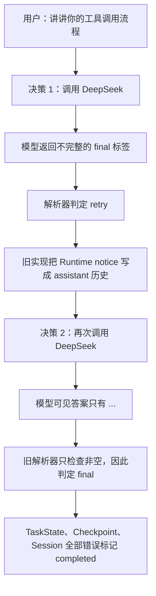
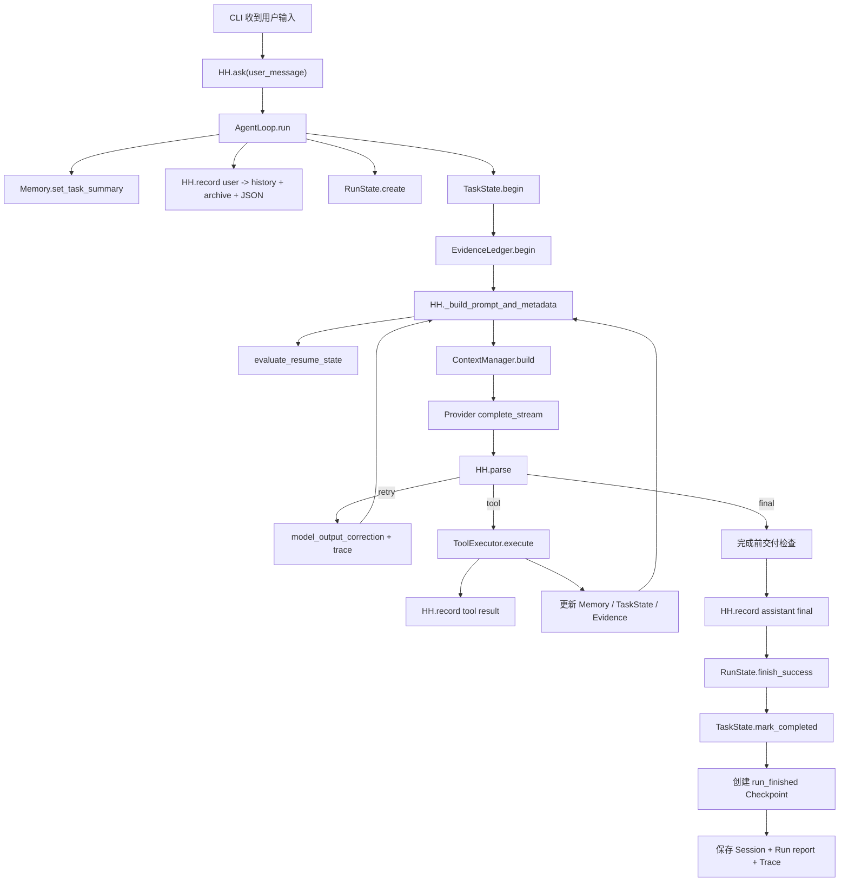

# HH Agent Pro：`...` 故障复盘与 Session 全字段源码指南

本文只讨论 `hh_agent_pro`，并以 Session `20260813-093305-8927c7` 和 Run
`run_20260813-093341-8df593` 为真实样本。

阅读完本文，你应该能回答四个问题：

1. 为什么 Agent 连续思考两轮，最后却只回答 `...`；
2. Session、History、Memory、TaskState、Checkpoint、RunState 和 Trace 各自负责什么；
3. Session JSON 每个字段由哪段代码建立、在什么时候赋值；
4. 本次修复怎样避免同类问题再次被误判为“任务成功”。

---

## 1. 先说结论：这次不是工具调用失败

这轮对话没有调用任何工具。

Run 的关键事实是：

```text
attempts = 2
tool_steps = 0
finish_reason = stop
output_truncated = false
final_answer = "..."
status = completed
```

所以它不是“工具步数不够”，也不是“输出 token 被截断”。真正过程是：



这次故障由两个代码缺口叠加造成：

- **纠错提示放错位置**：平台自己的格式纠错被保存成 `role=assistant`，让下一轮模型以为
  那是“自己刚刚说过的话”；
- **完成条件过宽**：旧解析器认为任何非空字符串都是答案，因而把 `...` 当成成功结果。

此外还有一个独立的 Session 噪音问题：每次 prefix 按固定分区预算裁切，旧代码都会创建
一个 `context_reduction` Checkpoint。一次重试就产生两个几乎相同的检查点。

---

## 2. 用 Trace 还原现场

真实 Trace 第一轮有：

```json
{
  "event": "model_parsed",
  "kind": "retry",
  "completion_metadata": {
    "finish_reason": "stop",
    "output_tokens": 430,
    "output_truncated": false
  }
}
```

紧接着的解析结果说明原因：

```text
Runtime notice: model returned an incomplete <final> answer.
```

这说明 DeepSeek 主动结束了返回，但返回协议不完整。`finish_reason=stop` 只表示服务端正常
停止生成，不代表文本符合 HH 的 `<final>...</final>` 协议。

第二轮 Trace 是：

```json
{
  "event": "model_parsed",
  "kind": "final",
  "completion_metadata": {
    "finish_reason": "stop",
    "output_tokens": 477,
    "output_truncated": false
  }
}
```

随后：

```json
{"event": "model_decision", "kind": "final", "text": "..."}
```

这证明两件事：

1. 不是 `max_new_tokens=2048` 导致的截断，因为 `output_truncated=false`；
2. 是 HH 的完成判定把 `...` 放行了。

`output_tokens=477` 看上去和三个点不相称。推测 DeepSeek 的 usage 包含了模型侧推理 token，
而用户可见 content 很短；当前 Trace 没保存完整原始响应，所以不能仅凭 usage 精确还原每个
token 的去向。但这不影响故障结论：HH 最终实际解析到的可见文本就是 `...`。

---

## 3. 修复一：默认模型改为 DeepSeek V4 Pro

入口位于 `hh_agent_pro/cli.py`。

```python
DEFAULT_DEEPSEEK_MODEL = "deepseek-v4-pro"

def _effective_model(args, provider):
    explicit_model = getattr(args, "model", None)
    if explicit_model:
        return explicit_model

    if provider == "deepseek":
        model = provider_env(
            "HH_DEEPSEEK_MODEL",
            ("DEEPSEEK_MODEL", "LLM_MODEL_ID"),
        )
        return model or DEFAULT_DEEPSEEK_MODEL
```

CLI 参数现在是：

```python
parser.add_argument(
    "--provider",
    choices=PROVIDER_NAMES,
    default="deepseek",
    help="Model backend to use. DeepSeek V4 Pro is the default.",
)
```

模型选择优先级仍然保持清晰：

```text
命令行 --model
    > 环境变量 HH_DEEPSEEK_MODEL
    > 代码默认 deepseek-v4-pro
```

因此直接运行：

```powershell
python -m hh_agent_pro
```

默认使用 `deepseek / deepseek-v4-pro`。多模型切换仍然保留：

```text
/model codex
/model deepseek
/model ollama qwen3.5:4b
/model openai gpt-5.4
/model anthropic claude-sonnet-4-6
```

如果 `.env` 中显式配置了其他 `HH_DEEPSEEK_MODEL`，环境变量会按设计覆盖代码默认值。

---

## 4. 修复二：平台纠错不再污染 assistant 历史

旧逻辑相当于：

```python
if kind == "retry":
    agent.record({
        "role": "assistant",
        "content": payload,
    })
    continue
```

问题是 `payload` 不是模型对用户说的话，而是 Runtime 对模型下达的内部指令。

正确设计位于 `hh_agent_pro/agent_loop.py`：

```python
if kind == "retry":
    agent.model_output_correction = str(payload)
    agent.emit_trace(
        run_state,
        "model_output_rejected",
        {"correction": clip(agent.redact_text(payload), 1000)},
    )
    agent.run_store.write_run_state(run_state)
    continue
```

现在它只进入临时字段 `model_output_correction`，并由
`hh_agent_pro/context_manager.py` 拼到当前请求旁边：

```python
correction = str(
    getattr(self.agent, "model_output_correction", "") or ""
).strip()

if correction:
    lines.extend([
        "",
        "Runtime format correction (authoritative):",
        correction,
    ])
```

这里的设计边界是：

```text
用户或模型真正说过的话       -> Session history
Runtime 对下一次决策的纠错    -> 当前 Prompt 的 authoritative directive
为什么拒绝了上次输出          -> Run trace
```

这样既能让下一轮模型看到纠错，也不会伪造一条 assistant 对话。

---

## 5. 修复三：`...` 不能再让任务完成

修复位于 `hh_agent_pro/runtime.py` 的 `HH.parse()`。

```python
if "<final>" in raw:
    if "</final>" not in raw:
        return "retry", HH.retry_notice(
            "model returned an incomplete <final> answer"
        )

    final = HH.extract(raw, "final").strip()
    if HH.looks_like_placeholder_answer(final):
        return "retry", HH.retry_notice(
            "model returned a placeholder instead of "
            "a meaningful <final> answer"
        )

    if final:
        return "final", final
```

纯文本最终答案也走相同检查：

```python
raw = raw.strip()
if HH.looks_like_placeholder_answer(raw):
    return "retry", HH.retry_notice(
        "model returned a placeholder instead of a meaningful answer"
    )
if raw:
    return "final", raw
```

占位符判断故意写得很窄：

```python
@staticmethod
def looks_like_placeholder_answer(raw):
    compact = re.sub(r"\s+", "", str(raw))
    return bool(compact) and all(
        character in ".。…·" for character in compact
    )
```

它会拒绝：

```text
...
……
 . . .
。。。
<final>...</final>
```

但不会误伤很短却可能正确的答案，例如 `是`、`否`、`ok`。这比设置一个武断的“至少
20 个字”规则更稳定。

---

## 6. 修复四：普通分区裁切不再制造 Checkpoint

本次 Trace 每个 Prompt 都有：

```json
{
  "section": "prefix",
  "reason": "section_budget",
  "before_chars": 7803,
  "after_chars": 5200
}
```

整个 Prompt 只有 6294 或 6560 字符，远低于 24000 总预算，所以这只是 prefix 的日常
定长裁切，不是危险的全局上下文淘汰。

旧实现只要看到任何 `budget_reductions` 就建检查点，因此一次普通问答加一次重试产生了
两个 `context_reduction` Checkpoint。

新逻辑只对 `total_budget` 建检查点：

```python
material_reductions = [
    item
    for item in prompt_metadata.get("budget_reductions", [])
    if item.get("reason") == "total_budget"
]

if material_reductions:
    agent.create_checkpoint(
        run_state,
        user_message,
        trigger="context_reduction",
    )
```

结果是：

- `section_budget` 仍保留在 Trace 和 Prompt metadata 中，便于观察；
- 真正超过总预算、必须淘汰上下文时，仍会建立恢复书签；
- Session 不再被每轮固定 prefix 裁切产生的重复检查点淹没。

---

## 7. Session 到底是什么

Session 是“可恢复的长期会话状态”，本质是一个 Python 字典，最终保存成 JSON。

新 Session 的骨架在 `hh_agent_pro/runtime.py` 的 `HH.__init__()` 中建立：

```python
self.session = session or {
    "id": datetime.now().strftime("%Y%m%d-%H%M%S")
          + "-" + uuid.uuid4().hex[:6],
    "created_at": now(),
    "workspace_root": str(self.root),
    "history": [],
    "memory": memorylib.default_memory_state(),
    "source_evidence": default_evidence_state(),
    "task_state": default_task_state(),
}
```

随后 `_ensure_session_shape()` 给旧版本 Session 补齐新字段。这使程序升级后仍能读取旧 JSON。

Session 最终由 `hh_agent_pro/session_store.py` 保存：

```python
def save(self, session):
    path = self.path(session["id"])
    with tempfile.NamedTemporaryFile(...) as handle:
        json.dump(
            session,
            handle,
            indent=2,
            ensure_ascii=False,
            sort_keys=True,
        )
    temp_path.replace(path)
    return path
```

先写临时文件、再替换正式文件，是为了避免程序在写到一半时留下损坏 JSON。

### 7.1 Session 不等于 Prompt

这是理解整个工程最关键的一点：

```text
Session = 磁盘里的完整可恢复状态
Prompt  = 某一次模型决策前，从 Session 等来源临时选出的有限视图
```

Session 可以保存很多历史，但 `ContextManager` 会按预算、相关性、角色和优先级选择真正
注入模型的内容。

---

## 8. 顶层字段总览

| 字段 | 含义 | 主要创建/赋值位置 |
|---|---|---|
| `id` | Session 唯一 ID，也是 JSON 文件名 | `runtime.py: HH.__init__ / _ensure_session_shape` |
| `created_at` | Session 创建时间，UTC ISO 字符串 | `runtime.py: HH.__init__` |
| `workspace_root` | 此 Session 所属仓库根目录 | `runtime.py: HH.__init__` |
| `history` | 用户、assistant、tool 的权威事件流 | `runtime.py: HH.record` |
| `archive_next_sequence` | 下一条消息的会话内顺序号 | `runtime.py: HH.record` |
| `memory` | 轻量工作记忆和笔记 | `features/memory.py` |
| `task_state` | 当前用户任务的语义进度 | `task_state.py`、`agent_loop.py` |
| `source_evidence` | 当前任务读过的文件和工具动作证据 | `evidence.py`、`agent_loop.py` |
| `checkpoints` | 可恢复的阶段性任务书签集合 | `checkpoint.py: create_checkpoint` |
| `resume_state` | 当前环境是否还能信任最新书签 | `checkpoint.py: evaluate_resume_state` |
| `runtime_identity` | 模型、目录、工具、预算等运行身份 | `checkpoint.py: current_runtime_identity` |
| `pending_output` | 连续两次输出截断后保留的未完成草稿 | `agent_loop.py` |

下面逐层解释。

---

## 9. `id`、`created_at`、`workspace_root`

样本：

```json
{
  "id": "20260813-093305-8927c7",
  "created_at": "2026-08-13T01:33:05.268374+00:00",
  "workspace_root": "C:\\Users\\ASUS\\OneDrive\\Desktop\\HundredHouses-Agent"
}
```

### `id`

- 用途：唯一定位 Session；文件路径通常是 `.hh/sessions/<id>.json`；
- 组成：本地可读时间前缀 + 随机短串；
- 随机短串避免同一秒启动两个会话时重名。

### `created_at`

- 用途：审计会话何时创建；
- `now()` 返回带时区的 ISO 时间；
- 样本中的 `01:33 UTC` 对应北京时间 `09:33`。

### `workspace_root`

- 用途：限制工具文件路径、计算相对路径、判断恢复时是否换了仓库；
- Session 不应拿到另一个仓库直接使用，否则旧文件摘要和检查点可能失真。

---

## 10. `history`：真正发生过的对话和工具事件

每条普通消息包含：

| 字段 | 含义 |
|---|---|
| `role` | `user`、`assistant` 或 `tool` |
| `content` | 实际文本内容 |
| `created_at` | 消息产生时间 |
| `archive_sequence` | 当前 Session 内从 0 递增的逻辑序号 |
| `archive_message_id` | SQLite Archive 中的全局消息行 ID |

工具调用时还可能出现：

```json
{
  "role": "assistant",
  "content": "",
  "tool_call": {
    "id": "call_xxx",
    "name": "read_file",
    "args": {"path": "a.py"}
  }
}
```

工具结果对应：

```json
{
  "role": "tool",
  "name": "read_file",
  "args": {"path": "a.py"},
  "content": "...",
  "tool_call_id": "call_xxx"
}
```

`tool_call.id` 与 `tool_call_id` 把“模型发起调用”和“Runtime 返回结果”配对。

### 10.1 字段在哪里赋值

所有消息统一走 `HH.record()`：

```python
def record(self, item):
    sequence_no = int(
        self.session.get("archive_next_sequence", 0)
    )
    item["archive_sequence"] = sequence_no
    self.session["archive_next_sequence"] = sequence_no + 1

    self.session["history"].append(item)
    item["archive_message_id"] = self.session_archive.append(
        self.session,
        sequence_no,
        item,
    )
    self.session_path = self.session_store.save(self.session)
```

调用链是：

```text
AgentLoop 收到用户输入
  -> HH.record(user)
模型请求工具
  -> HH.record(assistant + tool_call)
工具执行完成
  -> HH.record(tool + tool_call_id)
模型给出最终答案
  -> HH.record(assistant)
```

### 10.2 为什么同时有 JSON history 和 SQLite Archive

它们用途不同：

- JSON `history`：恢复当前 Session，简单直观；
- SQLite Archive：跨长会话搜索、分页读取、全文检索，不必把全部 JSON 塞给模型。

`SessionArchive.append()` 把消息插入 `messages` 表，并把数据库行 ID 返回给
`archive_message_id`。因此：

```text
archive_sequence  = 在这个 Session 里排第几条
archive_message_id = 在整个 Archive 数据库里是哪一行
```

### 10.3 样本 history 为什么能直接暴露故障

样本共有五条：

```text
0 user       询问当前模型
1 assistant  正确回答 deepseek-v4-pro
2 user       询问工具调用流程
3 assistant  Runtime notice: incomplete <final>
4 assistant  ...
```

第 3 条本不该是 assistant 消息。它是平台纠错，不是模型对用户的回答。修复后，此类信息只
进入当前 Prompt directive 和 Trace，不再写入 Session history。

---

## 11. `archive_next_sequence`

样本值是：

```json
"archive_next_sequence": 5
```

因为 history 已经有序号 `0、1、2、3、4` 五条消息，下一条应当使用 `5`。

每次 `HH.record()`：

```python
sequence_no = session["archive_next_sequence"]
item["archive_sequence"] = sequence_no
session["archive_next_sequence"] = sequence_no + 1
```

启动恢复时还会用已有 history 的最大序号校正它，避免旧 Session 缺字段或计数落后。

---

## 12. `memory`：轻量记忆，不是完整历史

默认结构来自 `hh_agent_pro/features/memory.py`：

```python
def default_memory_state():
    return {
        "working": {
            "task_summary": "",
            "recent_files": [],
        },
        "episodic_notes": [],
        "process_notes": [],
        "file_summaries": {},
        "next_note_index": 0,
    }
```

### `working.task_summary`

- 当前任务的一句话摘要；
- 每次 `AgentLoop.run(user_message)` 开始时调用
  `agent.memory.set_task_summary(user_message)`；
- 样本值正是“你讲讲你的工具调用流程是什么”。

### `working.recent_files`

- 最近接触的最多 8 个文件；
- `read_file`、`read_files`、写入或补丁工具成功后，由
  `HH.update_memory_after_tool()` 调用 `remember_file()` 更新；
- 样本没有工具调用，所以是空数组。

### `file_summaries`

- 键是规范化的工作区相对路径；
- 值包含文件短摘要和 freshness；
- freshness 通常是文件内容哈希，用来发现“摘要生成后文件又变了”；
- 上下文压缩掉原始读取结果后，可复用这里的小摘要。

### `episodic_notes`

- 与具体经历、事件、用户事实有关的短笔记；
- 有数量上限，避免无限增长；
- 检索时按当前问题相关性挑选，而不是全部注入。

### `process_notes`

- 与执行过程有关的短笔记，例如做过什么、遇到什么状态；
- 和用户/项目的长期稳定事实分开，降低临时过程污染长期记忆的风险。

### `next_note_index`

- 给新笔记生成稳定顺序号；
- 即使某些旧笔记被淘汰，也不重复使用旧编号。

样本的这些字段几乎全空，是合理现象：这轮只是问 Agent 自身流程，没有读文件或产生可提炼
的项目事实。

---

## 13. `task_state`：当前任务到底做到哪了

默认结构来自 `hh_agent_pro/task_state.py` 的 `default_task_state()`。

| 字段 | 含义 | 主要赋值点 |
|---|---|---|
| `schema_version` | TaskState 数据格式版本 | `default_task_state()` |
| `task_id` | 当前逻辑任务 ID | `TaskState._reset()` |
| `goal` | 用户任务目标 | `TaskState._reset()` |
| `status` | `idle/running/waiting_for_user/paused/blocked/completed` | `begin/mark_*` |
| `run_ids` | 承载该任务的 Run 列表 | `_reset()`、`begin()` |
| `continuation_requests` | 用户后续的“继续/补充”请求 | `begin()` |
| `subtask_ids` | 显式项目子任务 ID | `observe_tool()`、`record_claim()` |
| `evidence` | 工具、声明、后台结果、最终交付摘要 | `_append_evidence()` |
| `claims` | 需要验证或已经验证的结论 | `record_claim()` |
| `open_questions` | 需要用户补充的问题 | `mark_waiting()` |
| `failures` | 工具失败、是否可重试、是否已解决 | `observe_tool()` |
| `next_action` | 恢复任务后下一步做什么 | 各状态方法 |
| `created_at` | 当前任务创建时间 | `_reset()` |
| `updated_at` | 最近一次状态变化时间 | `_touch()` |

每轮开始：

```python
agent.task_state.begin(user_message, run_state.run_id)
```

如果上一任务已完成，新问题会触发 `_reset()`：

```python
self.state.update({
    "task_id": "taskrun_" + uuid.uuid4().hex[:10],
    "goal": clip(goal, 1000),
    "status": "running",
    "run_ids": [run_id],
    "created_at": now(),
    "updated_at": now(),
})
```

模型最终答案通过交付检查后：

```python
def mark_completed(self, final_answer):
    self.state["status"] = "completed"
    self.state["next_action"] = ""
    self._append_evidence({
        "kind": "delivery",
        "summary": clip(final_answer, 500),
        "created_at": now(),
    })
```

样本出现：

```json
"status": "completed",
"evidence": [{"kind": "delivery", "summary": "..."}]
```

它不是 TaskState 自己判断错了，而是上游解析器错误地把 `...` 定义成了合法 final，
`AgentLoop` 才正常调用 `mark_completed("...")`。所以修复应该发生在完成入口，而不是让
TaskState 猜测语言质量。

---

## 14. `source_evidence`：当前任务的源码证据账本

默认结构来自 `hh_agent_pro/evidence.py`：

```python
def default_evidence_state():
    return {
        "schema_version": "v1",
        "task_id": "",
        "next_id": 1,
        "files": {},
        "actions": [],
        "updated_at": now(),
    }
```

| 字段 | 含义 |
|---|---|
| `schema_version` | 证据账本格式版本 |
| `task_id` | 证据属于哪个 TaskState |
| `next_id` | 下一个文件证据编号，例如 `E1` |
| `files` | 按路径保存的源码证据 |
| `actions` | 最近的工具动作摘要 |
| `updated_at` | 最近更新时间 |

每个新逻辑任务开始时：

```python
agent.source_evidence.begin(
    agent.task_state.to_dict().get("task_id", "")
)
```

如果 task ID 变了，旧任务证据会清空，防止把上一个问题读过的文件误当成当前问题证据。

### `files` 中每个文件项

`EvidenceLedger.record_file()` 产生：

```python
item = {
    "id": evidence_id,
    "path": canonical,
    "summary": clip(summary, 700),
    "start": int(start or 1),
    "end": int(end) if end is not None else None,
    "total_lines": int(total_lines) if total_lines else None,
    "complete": ...,
    "freshness": self._freshness(canonical),
    "source_tool": str(source_tool),
    "updated_at": now(),
}
```

- `start/end/total_lines`：读了文件哪一段；
- `complete`：是否覆盖完整文件；
- `summary`：确定性源码摘要；Python 文件会优先抽取模块说明、类、函数和 import；
- `freshness`：当前文件哈希；
- `source_tool`：证据来自 `read_file` 还是其他工具。

### `actions`

每次工具执行后，AgentLoop 调用：

```python
agent.source_evidence.record_action(
    name,
    args,
    status=...,
    cache_hit=...,
)
```

动作项包含：

```text
tool、args、status、cache_hit、created_at
```

样本中 `files={}`、`actions=[]` 再次证明本轮没有任何工具调用。

---

## 15. `checkpoints`：任务恢复书签

顶层结构：

```json
{
  "current_id": "ckpt_ea46e8b1",
  "items": {
    "ckpt_ea46e8b1": {"...": "..."}
  }
}
```

- `current_id`：最新、默认用于恢复的 Checkpoint ID；
- `items`：所有保留的 Checkpoint，以 ID 为键；
- 当前最多保留 100 个，超出后淘汰最旧项。

每个 Checkpoint 由 `hh_agent_pro/checkpoint.py:create_checkpoint()` 生成。

| 字段 | 含义 | 值的来源 |
|---|---|---|
| `checkpoint_id` | 本书签 ID | `ckpt_` + 随机串 |
| `parent_checkpoint_id` | 上一个书签 ID | 创建前的 `current_id` |
| `schema_version` | 书签格式版本 | `CHECKPOINT_SCHEMA_VERSION` |
| `created_at` | 创建时间 | `now()` |
| `current_goal` | 当前用户目标 | `task_state.goal`，回退到 user message |
| `task_state_id` | 对应任务 ID | `task_state.task_id` |
| `task_status` | 创建时任务状态 | `task_state.status` |
| `completed` | 已完成子任务及最终回答摘要 | `completed_summaries()` + final |
| `excluded` | 明确排除项 | 当前实现预留，默认 `[]` |
| `current_blocker` | 当前阻塞原因 | `task_state.blocker_summary()` 或 stop reason |
| `next_step` | 恢复后的下一步 | `task_state.next_action` 或 `infer_next_step()` |
| `verified_claims` | 最近已验证结论 | `task_state.claims` |
| `open_questions` | 等用户补充的问题 | `task_state.open_questions` |
| `evidence` | 最近证据摘要 | `task_state.evidence` |
| `key_files` | 关键文件及 freshness | `memory.working.recent_files` |
| `freshness` | `path -> 文件哈希` 映射 | `file_freshness()` |
| `summary` | 建书签的触发原因和请求摘要 | `trigger + user_message` |
| `runtime_identity` | 创建时的运行环境 | `current_runtime_identity()` |

### 15.1 样本为什么有五个 Checkpoint

两轮用户问题正常结束，各会有一个 `run_finished` Checkpoint；旧逻辑还把每次
`section_budget` prefix 裁切当成 `context_reduction`，第二个问题又重试了一次，所以出现：

```text
问题一：context_reduction + run_finished
问题二：context_reduction + context_reduction + run_finished
总计：5
```

修复后，常规 `section_budget` 不建书签。类似的两个纯问答正常只留下两个
`run_finished` Checkpoint；只有真实 `total_budget` 淘汰上下文时才额外建立恢复书签。

### 15.2 为什么最终 Checkpoint 也被 `...` 污染

`AgentLoop` 的成功顺序是：

```python
agent.record(assistant_final)
run_state.finish_success(final)
agent.task_state.mark_completed(final)
self._finalize_run(...)
```

`_finalize_run()` 再创建 `run_finished` Checkpoint。因此解析器一旦错误放行 `...`，
后续各层都会一致地记录这个“成功”。这叫上游判定污染，不是五个模块分别犯错。

---

## 16. `runtime_identity`：这还是原来的运行环境吗

生成函数是 `checkpoint.py:current_runtime_identity()`：

```python
return {
    "session_id": agent.session.get("id", ""),
    "cwd": str(agent.root),
    "model": str(agent.model_client.model),
    "model_client": agent.model_client.__class__.__name__,
    "approval_policy": agent.approval_policy,
    "read_only": bool(agent.read_only),
    "max_steps": int(agent.max_steps),
    "max_new_tokens": int(agent.max_new_tokens),
    "feature_flags": dict(agent.feature_flags),
    "shell_env_allowlist": list(agent.shell_env_allowlist),
    "workspace_fingerprint": agent.workspace.fingerprint(),
    "tool_signature": agent.tool_signature(),
}
```

逐项含义：

| 字段 | 为什么要记 |
|---|---|
| `session_id` | 防止把其他 Session 的身份误套过来 |
| `cwd` | 目录变化意味着相对路径语义变化 |
| `model` | 切模型后行为和上下文能力可能不同 |
| `model_client` | Codex CLI、Chat Compatible 等请求协议不同 |
| `approval_policy` | `ask/auto/never` 会改变工具能否执行 |
| `read_only` | 是否禁止修改工作区 |
| `max_steps` | 工具预算是否变化 |
| `max_new_tokens` | 输出上限是否变化 |
| `feature_flags` | 压缩、委派等功能开关是否变化 |
| `shell_env_allowlist` | Shell 可见环境变量名是否变化 |
| `workspace_fingerprint` | 仓库基础状态指纹是否变化 |
| `tool_signature` | 当前工具集合及 schema 是否变化 |

你之前认为 `run_state` 经常变化、看起来没用；`runtime_identity` 也会变化，但它不是为了给
人阅读“进度”，而是用于恢复安全检查。模型、工具 schema 或目录换了，旧 Checkpoint 不能
被无条件视为可靠。

注意：`shell_env_allowlist` 只保存允许的变量**名称**，不是密钥值。

---

## 17. `resume_state`：最新 Checkpoint 还能信多少

结构：

| 字段 | 含义 |
|---|---|
| `status` | 总体恢复状态 |
| `stale_paths` | freshness 已变化或文件已删除的关键路径 |
| `runtime_identity_mismatch_fields` | 哪些运行身份字段变了 |
| `stale_summary_invalidations` | 因文件过期而失效的摘要数量 |

状态可能是：

```text
no-checkpoint       没有旧书签
full-valid          文件和运行环境都匹配
partial-stale       某些关键文件已变化
workspace-mismatch  模型、目录、工具或配置变化
schema-mismatch     Checkpoint 数据版本不兼容
```

核心函数是 `evaluate_resume_state()`：

```python
checkpoint = current_checkpoint(agent)

for item in checkpoint.get("key_files", []):
    current = file_freshness(item["path"], agent.root)
    if item["freshness"] != current:
        stale_paths.append(item["path"])

for key in RUNTIME_IDENTITY_KEYS:
    if saved_identity.get(key) != current_identity.get(key):
        mismatch_fields.append(key)
```

样本是：

```json
{
  "status": "full-valid",
  "stale_paths": [],
  "runtime_identity_mismatch_fields": [],
  "stale_summary_invalidations": 0
}
```

意思不是“回答质量完全正确”，而只是“最新 Checkpoint 对应的文件和运行环境没有失配”。
`resume_state` 不负责评价自然语言答案质量。

---

## 18. `pending_output`：未完成输出草稿

样本是空对象：

```json
"pending_output": {}
```

这也是“本次不是输出截断”的一个旁证。

只有模型连续两次因为输出 token 上限截断时，AgentLoop 才保存：

```python
agent.session["pending_output"] = {
    "original_request": str(user_message),
    "partial_answer": partial,
    "run_id": run_state.run_id,
    "created_at": now(),
}
```

字段含义：

- `original_request`：未答完的原问题；
- `partial_answer`：已经生成的可见草稿；
- `run_id`：发生截断的 Run；
- `created_at`：保存时间。

用户下一轮只输入“继续”时，AgentLoop 会恢复草稿，切到 `final_only_mode`，禁止重新调用工具，
要求模型只补缺失部分。新问题到来时则清空旧草稿，避免以后一个“继续”恢复错任务。

---

## 19. 这些对象到底如何分工

| 对象 | 生命周期 | 回答的问题 | 是否直接注入 Prompt |
|---|---|---|---|
| Session | 多轮、可跨重启 | 这段会话保存了什么 | 不整体注入 |
| History | 多轮事件流 | 用户、模型、工具当时说了什么 | 经压缩和角色整理后注入 |
| Memory | 多轮精炼状态 | 哪些小事实值得继续带着 | 按预算/相关性注入 |
| TaskState | 一个逻辑用户任务 | 目标、证据、失败、下一步是什么 | 高优先级注入 |
| SourceEvidence | 一个逻辑用户任务 | 当前结论读过哪些源文件 | 高保底预算注入 |
| Checkpoint | 任务阶段 | 中断后从哪里继续 | 最新书签摘要注入 |
| ResumeState | 每次建 Prompt 前重算 | 旧书签还能否信任 | 作为恢复提示注入 |
| RunState | 一次 `ask()` | 调了几次模型/工具，为什么停止 | 摘要进入 Prompt，完整体进 Run artifact |
| Trace | 单次 Run 的时间序列 | 平台每一步究竟发生了什么 | 不注入模型 |

### 为什么不能只看 Session history

对简单问答，history 确实最直观；这次它甚至一眼暴露了 Runtime notice 污染。

但它无法完整回答：

- 第一次模型请求用了多少 token；
- Provider 的 `finish_reason` 是 `stop` 还是 `length`；
- Prompt 哪个分区被压缩；
- 工具结果来自执行还是缓存；
- 某个 Checkpoint 因为什么触发；
- 模型输出是怎样被解析为 `retry/final/tool` 的。

这些必须看 Trace。更准确的定位是：

```text
Session history = 用户可理解的权威会话记录
Trace           = Runtime 工程诊断记录
RunState        = 单次运行的最终状态快照
```

你的原判断有一半是对的：旧 Trace 如果只重复“started/completed”，确实不够有用；但这次
真正完成根因定位的正是 Trace 中的 `model_parsed`、`finish_reason`、
`output_truncated`、`budget_reductions` 和 `tool_steps`。正确方向不是删掉 Trace，而是让
Session 保持干净，让 Trace 专注工程事实。

---

## 20. 从用户输入到 Session 落盘的完整跳转



源码阅读建议顺序：

```text
cli.py
  -> runtime.py: HH.ask / HH.record / HH.parse
  -> agent_loop.py: AgentLoop.run
  -> context_manager.py: build / provider_request
  -> task_state.py
  -> evidence.py
  -> checkpoint.py
  -> session_store.py
  -> memory/session_archive.py
```

---

## 21. 修复后的预期行为

如果模型再次先返回不完整 `<final>`，然后返回 `...`：

```text
第一次输出
  -> parse = retry
  -> 写 model_output_rejected trace
  -> 纠错只注入当前 Prompt
  -> 不写 assistant history

第二次输出 "..."
  -> placeholder 检查 = retry
  -> 不能 finish_success
  -> 不能 mark_completed
  -> 不能生成 "completed: ..." Checkpoint
```

模型之后若能给出真实答案，则正常完成；如果持续给出畸形或占位回答，最终会以
`retry_limit`/协议错误方式暂停，而不是伪装成功。

---

## 22. 测试结论

本次执行：

```powershell
.\.venv\Scripts\python.exe -m pytest -q
```

结果：

```text
182 passed
```

新增或扩展的关键回归覆盖：

1. 不传 `--provider` 时默认为 `deepseek`；
2. 不传 `--model` 且无环境覆盖时默认为 `deepseek-v4-pro`；
3. Codex、Ollama、OpenAI、Anthropic 仍在可选 provider 列表中；
4. `...`、`……`、` . . . `、`。。。` 被拒绝；
5. `<final>...</final>` 和 `<final>……</final>` 也被拒绝；
6. 第一次格式错误后，第二次 Prompt 能看到 Runtime correction；
7. Runtime correction 不会作为 assistant 消息写入 Session history；
8. Trace 会出现 `model_output_rejected`，仍然保留诊断能力；
9. 全量既有工具、记忆、上下文、Session 和多模型测试没有回归。

测试只证明确定性代码行为和回归兼容性，不等于证明真实 DeepSeek 在所有问题上都一定回答
正确。真实模型仍可能波动，但 Runtime 现在不会再把纯省略号错误包装成成功任务。

---

## 23. 一段可以直接复述的项目讲解

> HH Agent Pro 把“保存”和“给模型看”分成了两层。Session 保存完整可恢复状态，包括
> history、轻量 memory、当前 TaskState、源码 Evidence、Checkpoint 和运行身份；
> ContextManager 每次只从这些状态中选出当前决策需要的有限视图，并按分区预算压缩。
> History 只记录用户、模型和工具真正发生过的事件，平台纠错属于 Runtime 指令，只进入
> 下一轮 Prompt 和 Trace，不能冒充 assistant 消息。模型输出先经过协议解析和完成条件
> 校验，只有真实有效的 final 才能推进 RunState、TaskState 和 Checkpoint 到 completed。
> Trace 用于解释请求、压缩、解析和工具执行过程，Session history 用于理解对话，两者不再
> 混在一起。本次还把默认 Provider 改为 DeepSeek V4 Pro，并通过 182 项测试验证兼容性。
