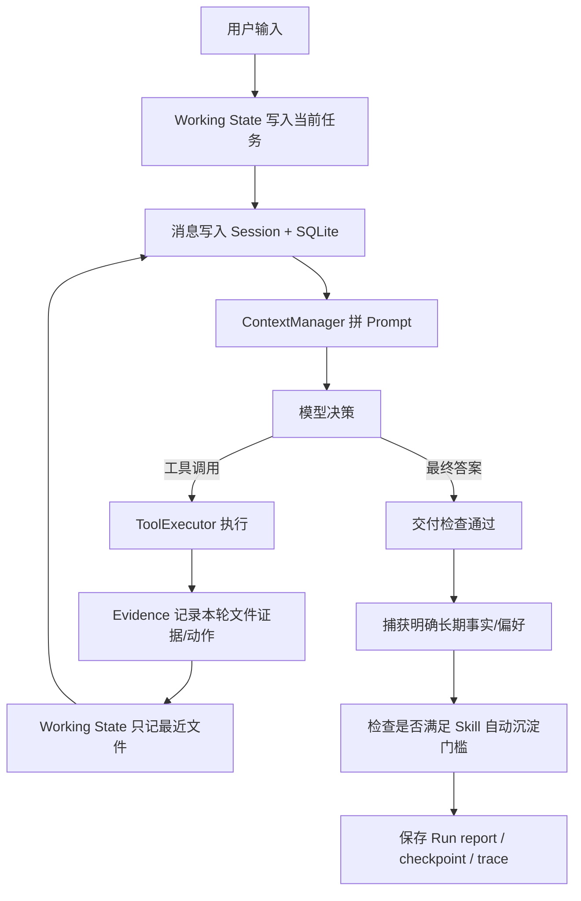

# HH Agent Pro 记忆与 Skills 重构：Hermes 风格的清晰四层设计

## 1. 先说结论

旧系统的主要问题不是“记不住”，而是“什么都叫记忆”。同一次 `read_file` 的信息可能同时出现在：

- Session history；
- `file_summaries`；
- `episodic_notes`；
- `source_evidence`。

一次工具失败又可能同时进入：

- `process_notes`；
- `task_state`；
- ToolExecutor 的失败状态；
- trace。

副本越多，越容易出现一个副本已经更新、另一个仍是旧值。模型看到的 Prompt 也会重复、冲突，开发者很难回答“到底以谁为准”。

重构后只保留四个层次：

| 层 | 一句话用途 | 存储 | 是否默认注入 Prompt |
|---|---|---|---|
| 当前工作状态 | 这一轮在做什么、最近碰过哪些文件 | Session JSON 的 `memory` 字段 | 是，极小块 |
| 精选长期记忆 | 用户偏好、稳定事实、项目约定和决策 | `.hh/memory/curated.json` | 是，会话开始时冻结 |
| 会话档案 | 过去真正说过、调用过什么 | Session JSON + SQLite FTS5 | 否，搜索时才读取 |
| Skills | 成功做事的方法和检查流程 | `.hh/skills/<name>/SKILL.md` | 只注入名称和描述；正文按需读取 |

另外三类经常被误叫成记忆的对象，现在明确排除：

- `EvidenceLedger` 是当前任务的代码证据，不是跨任务记忆；
- `TaskState` 是任务控制状态，不是记忆；
- trace 是调试事件流，不是模型回忆来源。

最重要的原则是：

> 事实进 Memory，做法进 Skill，过程进 Session，当前执行进 Working State，交付依据进 Evidence。

---

## 2. 原项目中哪些设计本来就是好的

这次不是推倒重写。下面这些能力本身是可用的，而且与 Hermes 的方向高度一致，因此被保留：

### 2.1 `CuratedMemoryStore` 的骨架是好的

它已经具有：

- `add / replace / remove / batch`；
- 唯一子串匹配，避免改错条目；
- 原子批量写入，失败不会只写一半；
- 容量上限，满了就报错，不静默驱逐；
- provenance、confidence、version；
- 线程锁和跨进程文件锁；
- 密钥和 Prompt Injection 扫描；
- workspace 与 global user 两种作用域；
- 会话开始时冻结快照。

这些正是 Hermes 持久记忆的关键特征。核心实现仍在：

- `hh_agent_pro/memory/curated_store.py`
- `CuratedMemoryStore.apply_batch()`
- `CuratedMemoryStore.render_snapshot()`

### 2.2 `SessionArchive` 的方向是好的

完整历史不应该全部塞进每一轮 Prompt。现有 SQLite + FTS5 设计允许模型：

1. 先用 `session_search` 找到过去的实际消息；
2. 再用 `session_read` 读取命中位置前后的时间窗口；
3. 保留 session id、message id、sequence number，可追溯到原文。

这比“让模型把所有旧历史压成一段不可验证摘要”更可靠。

### 2.3 ContextManager 的分区预算是好的

按 section 分配预算、超限时有明确牺牲顺序、最新请求不裁切、关键 Prefix 有最低保护线，这些都应该保留。

问题只在于旧 section 中放了重复数据。本次替换内容边界，没有否定预算框架。

### 2.4 任务、检查点和交付阻塞骨架可以继续使用

任务持久化、依赖、检查点、后台任务和交付前 blocker 都是 Agent harness 的有效组成部分。它们属于“执行控制”，不应该被包装成记忆。

---

## 3. Codex、Claude Code、Hermes 的机制对比

这里依据公开文档进行对照，不推测产品内部未公开实现。

| 系统 | 稳定规则/事实 | 历史 | 可复用流程 | 核心取舍 |
|---|---|---|---|---|
| Codex | `AGENTS.md` 分层加载 | 当前任务上下文由运行时管理 | Agent Skills，目录先发现，`SKILL.md` 按需加载 | 项目规则与可复用流程分开，渐进披露 |
| Claude Code | `CLAUDE.md` + auto memory 的 `MEMORY.md`/topic files | 会话内上下文及压缩 | `.claude/skills/<name>/SKILL.md` | 稳定指令、自动记忆、Skill 各有位置 |
| Hermes | 有界 `MEMORY.md` + `USER.md`，会话开始冻结 | SQLite FTS5，按需 `session_search` | L0 目录、L1 `SKILL.md`、L2 references/scripts；可后台沉淀 | 事实、用户画像、历史、程序性知识严格分层 |

参考资料：

- [OpenAI：Build Skills](https://learn.chatgpt.com/docs/build-skills)
- [OpenAI：AGENTS.md](https://learn.chatgpt.com/docs/agent-configuration/agents-md)
- [OpenAI：Reusable Codex skills](https://learn.chatgpt.com/codex/use-cases/reusable-codex-skills)
- [Claude Code：Manage Claude's memory](https://code.claude.com/docs/en/memory)
- [Claude Code：Extend Claude with skills](https://code.claude.com/docs/en/skills)
- [Hermes：Persistent Memory](https://hermes-agent.nousresearch.com/docs/user-guide/features/memory)
- [Hermes：Skills System](https://hermes-agent.nousresearch.com/docs/user-guide/features/skills)
- [Hermes：Sessions](https://hermes-agent.nousresearch.com/docs/user-guide/sessions)

### 3.1 本项目最终采用了什么

以 Hermes 的边界为主，吸收 Codex/Claude 的 Skill 标准：

- 长期事实小而有界、会话开始冻结；
- 用户画像和 workspace 事实使用不同 namespace/scope；
- 历史完整保存，用 FTS5 按需检索；
- Skill 使用标准 `SKILL.md` 目录结构；
- Prompt 只注入 Skill 的 name + description；
- Skill 正文通过工具按需载入；
- 成功复杂流程可以自动沉淀；
- `AGENTS.md` 继续作为项目规则，而不是复制到长期记忆。

---

## 4. 四层记忆在什么时候产生、存储、注入、提取、消除

### 4.1 当前工作状态 Working State

它只保存：

```json
{
  "schema_version": 3,
  "task_summary": "修复解析器并运行测试",
  "recent_files": ["app.py", "tests/test_app.py"]
}
```

产生时间：

- 每次 `ask(user_message)` 开始，写入 `task_summary`；
- 成功读写文件后，路径进入 `recent_files`。

存储位置：

- 当前 Session JSON 的 `memory` 字段。

注入时间：

- 每次模型决策前，作为 `Current working state` 小块注入。

提取方式：

- 不做语义检索；内容太小，直接渲染。

消除方式：

- `/reset` 清空；
- 新任务覆盖 `task_summary`；
- 文件列表只保留最近 8 个。

核心代码在 `hh_agent_pro/memory/working.py`：

```python
def default_working_state():
    return {
        "schema_version": SCHEMA_VERSION,
        "task_summary": "",
        "recent_files": [],
    }


class WorkingMemory:
    def set_task_summary(self, summary):
        self.state["task_summary"] = clip(str(summary).strip(), 300)
        return self

    def remember_file(self, path):
        path = self.canonical_path(path)
        files = [item for item in self.state["recent_files"] if item != path]
        files.append(path)
        self.state["recent_files"] = files[-RECENT_FILE_LIMIT:]
        return self
```

为什么没有文件摘要：文件摘要已经由 EvidenceLedger 保存。Working State 只负责导航，不负责内容证据。

为什么没有 episodic notes：过去发生的事件已经在 Session history 和 SQLite 中。

为什么没有 process notes：失败和重试已经由 ToolExecutor 与 TaskState 管理。

### 4.2 精选长期记忆 Curated Durable Memory

适合保存：

- 用户偏好：“我偏好简洁、直接的回答”；
- 项目约定：“Python lint 统一使用 Ruff”；
- 稳定依赖：“数据库使用 SQLite”；
- 长期决策与纠正。

不保存：

- 当前做到哪一步；
- TODO、临时 blocker；
- 原始日志和整段代码；
- 可随时从文件重新读取的内容；
- 工具调用方法——方法应该进入 Skill。

存储位置：

```text
.hh/memory/curated.json
```

两个逻辑目标：

```text
namespace=user, scope=global_user
  用户偏好和沟通习惯

namespace=memory, scope=workspace/project
  项目事实、约定、决策和依赖
```

注入机制：

1. 创建 `CodingAgent` 时读取磁盘；
2. 调用 `render_snapshot()`；
3. 保存到 `curated_memory_snapshot`；
4. 当前 Session 后续即使写入新记忆，也不改变这份 Prompt 快照；
5. 下一 Session 才看到新内容。

冻结不是延迟 bug，而是为了：

- 保持一轮会话的系统前缀稳定；
- 避免模型中途看到“自己刚写的新事实”后循环强化；
- 提高 Prompt cache 命中率；
- 让调试可复现。

精确修改由 `apply_batch()` 完成：

```python
def apply_batch(self, operations):
    with _THREAD_LOCK, _file_lock(self.lock_path):
        data = self._read()
        entries = [MemoryEntry.from_dict(item) for item in data["entries"]]
        results = []
        for raw_operation in operations:
            entries, result = self._apply_one(entries, raw_operation)
            results.append(result)
        self._check_capacity(entries)
        data = {
            "schema_version": SCHEMA_VERSION,
            "revision": int(data.get("revision", 0)) + 1,
            "entries": [entry.to_dict() for entry in entries],
        }
        self._write(data)
        return results
```

关键点是先在内存完成整批校验，再整体原子替换文件。第二个操作失败时，第一个操作不会单独落盘。

#### 自动捕获长期事实

`DurableMemoryLearner` 只处理两类高置信输入：

- 用户明确说“请记住……”；
- 用户明确表达稳定偏好，如“我偏好……”。

它不会让模型自由猜测。代码位于 `hh_agent_pro/memory/learner.py`：

```python
def capture(self, user_message, session_id=""):
    operations = self.extract(user_message)
    if not operations:
        return {
            "status": "skipped",
            "reason": "no_explicit_durable_fact",
            "results": [],
        }
    for operation in operations:
        operation["source_session_id"] = str(session_id)
    try:
        results = self.store.apply_batch(operations)
    except MemoryError as exc:
        return {"status": "rejected", "reason": str(exc), "results": []}
    ...
```

为什么保守：错误长期记忆会在未来每一轮污染 Prompt，漏存一条事实通常只需要重新询问，错存一条事实却会持续误导 Agent。

手动管理工具仍然存在：

- `memory_list`；
- `memory_update add`；
- `memory_update replace`；
- `memory_update remove`；
- `memory_update batch`。

### 4.3 会话档案 Session Archive

产生时间：每次记录 user、assistant、tool 消息时。

存储位置：

- Session JSON：恢复当前会话的权威记录；
- `archive.sqlite3`：跨会话全文检索索引。

默认是否注入：

- 当前 Session 的近期 history 会进入 Prompt；
- 老消息由 ContextManager 压缩、折叠重复读取；
- 其他 Session 不默认注入。

提取方式：

```text
session_search(query)
    ↓ 返回 session_id / message_id / sequence_no
session_read(session_id, around_message_id)
    ↓ 返回命中点附近的真实时间顺序消息
```

消除方式：

- `/reset` 清当前 Session history；
- 长期归档目前不自动删除；
- 如果未来加入保留策略，应按 Session 删除，而不是把历史内容误删到长期事实中。

历史记录是“当时说过什么”，不是“现在一定还是真的”。例如历史里说测试通过，但文件后来变了，就必须重新运行测试。

### 4.4 Skills：程序性记忆

Skill 保存的是“怎么做”，不是“是什么”。

目录结构：

```text
.hh/skills/
└── learned-app-a1b2c3d4/
    └── SKILL.md
```

`SKILL.md` 示例：

```markdown
---
name: learned-app-a1b2c3d4
description: "Auto-learned verified workflow for: 修复解析并运行测试"
auto_generated: true
source_signature: a1b2c3d4e5f67890
---

# learned-app-a1b2c3d4

## When to use
修复同类解析问题并验证。

## Procedure
1. Run `read_file` with `path=app.py`.
2. Run `search` with `pattern=parse, path=.`.
3. Run `patch_file` with `path=app.py`.
4. Run `run_shell` with `command=pytest -q`.

## Verification
- Re-run `command=pytest -q` and require a successful exit.
```

#### 渐进披露

Prompt 中只有：

```text
Available skills (procedures; bodies load only with skill_view):
- release-check: Verify and publish a release
- learned-app-a1b2c3d4: Auto-learned verified workflow for ...
```

不会把所有 Skill 正文塞进 Prompt。

模型认为某个 Skill 匹配时：

```text
skills_list（可选，读取实时目录）
    ↓
skill_view(name)
    ↓
完整 SKILL.md 作为工具结果进入下一轮上下文
```

`SkillStore.render_index()` 和 `read()` 的边界：

```python
def render_index(self):
    lines = [
        "Available skills (procedures; bodies load only with skill_view):",
        "- Match the current task to a description. "
        "Call skill_view before following a matching skill.",
    ]
    for skill in self.list():
        lines.append(f"- {skill.name}: {skill.description}")
    return "\n".join(lines)[:MAX_INDEX_CHARS]

def read(self, name):
    path = self._path(name)
    if not path.is_file():
        raise SkillError(f"skill not found: {name}")
    ...
    return text
```

#### Skill 的三个工具

| 工具 | 作用 | 风险 |
|---|---|---|
| `skills_list` | 读取实时 name + description 目录 | 只读 |
| `skill_view` | 按需读取一个完整 `SKILL.md` | 只读 |
| `skill_manage` | create / patch / delete | 需要风险审批 |

#### 自动沉淀门槛

`SkillLearner.consider()` 只有同时满足以下条件才落盘：

1. Run 状态是 `completed`；
2. 至少 5 次有效工具调用；
3. 至少 5 个成功动作；
4. 确实执行过 `write_file` 或 `patch_file`；
5. 修改之后成功执行过 `run_shell` 验证；
6. 不是与已有 Skill 相同的工具流程签名；
7. 内容不含密钥或高优先级指令覆盖文本。

核心判断：

```python
if str(getattr(run_state, "status", "")) != "completed":
    return {"status": "skipped", "reason": "run_not_completed"}
if int(getattr(run_state, "tool_steps", 0)) < self.minimum_tool_steps:
    return {"status": "skipped", "reason": "too_few_tool_steps"}

mutation_indexes = [
    index for index, action in enumerate(actions)
    if action.get("tool") in MUTATION_TOOLS
    and action.get("status") == "ok"
]
verified_after_edit = any(
    index > min(mutation_indexes)
    and action.get("tool") == "run_shell"
    and action.get("status") == "ok"
    for index, action in enumerate(actions)
) if mutation_indexes else False
```

它不会保存 `patch_file` 的 `old_text/new_text` 或 `write_file` 的整段 content，避免把源代码、密钥或巨大文本复制进 Skill。它只记录工具、路径、查询和验证命令。

自动 Skill 的签名由规范化后的成功工具序列计算。相同流程第二次成功时返回 `duplicate`，不会再生成一份。

自动沉淀可用以下参数关闭：

```powershell
python -m hh_agent_pro --no-auto-skills
```

---

## 5. 一轮 Agent Loop 中到底发生了什么



成功结束处的真实调用顺序位于 `hh_agent_pro/agent_loop.py`：

```python
agent.record({"role": "assistant", "content": final, "created_at": now()})
run_state.finish_success(final)
agent.task_state.mark_completed(final)
agent.auto_capture_durable_memory(user_message)
agent.auto_deposit_skill(user_message, final, run_state)
self._finalize_run(...)
```

这里故意只有成功 Run 才自动学习。blocked、等待用户输入、模型错误或步数耗尽都不会生成 Skill。

---

## 6. Prompt 最终怎么拼

当前顺序：

```text
1. prefix
2. working_memory
3. durable_memory
4. task_state
5. evidence
6. skills
7. history
8. current_request
```

对应 `hh_agent_pro/context_manager.py` 的 `SECTION_ORDER`。

这样排序的理由：

- Prefix 是身份、规则、工具协议，最稳定；
- Working/Durable 先告诉模型当前目标和稳定事实；
- Task/Evidence 告诉模型本轮执行与已核实代码；
- Skill 目录告诉模型有哪些方法可以按需加载；
- History 提供对话连续性；
- 当前请求放最后，使模型最接近用户最新意图。

最终拼接：

```python
def _assemble_prompt(self, rendered):
    return "\n\n".join(
        [
            rendered["prefix"].rendered,
            rendered["working_memory"].rendered,
            rendered["durable_memory"].rendered,
            rendered["task_state"].rendered,
            rendered["evidence"].rendered,
            rendered["skills"].rendered,
            rendered["history"].rendered,
            rendered[CURRENT_REQUEST_SECTION].rendered,
        ]
    ).strip()
```

旧的 `relevant_memory` section 已删除，因为它召回的正是 `episodic_notes/process_notes`，与 Session/TaskState 重叠。现在按需召回只发生在两个清晰入口：

- 找过去说过什么：`session_search/session_read`；
- 找过去成功的方法：`skills_list/skill_view`。

---

## 7. 旧 Session 如何迁移

旧 Session 不需要手动改 JSON。

`normalize_working_state()` 会读取：

- 新的 `task_summary/recent_files`；
- 或旧的 `working.task_summary/working.recent_files`；
- 或更旧的 `task/files`。

但它故意不迁移：

- `file_summaries`；
- `episodic_notes`；
- `process_notes`；
- `next_note_index`。

原因不是丢数据：这些旧内容仍在原 Session 文件历史中，且 SQLite archive 可检索。只是不再把它们恢复成会持续注入的新运行状态。

原来的 `hh_agent_pro/features/memory.py` 已缩成兼容导入桥。真正实现全部集中在 `hh_agent_pro/memory/`，解决“一个 memory 目录外面又有一个 memory.py”的结构混乱。

---

## 8. 安全和稳定性

### 8.1 长期记忆安全

- 容量严格限制；
- 原子文件替换；
- 线程锁 + 跨进程锁；
- exact duplicate 拒绝；
- replace/remove 必须唯一匹配；
- 密钥模式拒绝；
- Prompt Injection 模式拒绝；
- 当前 Session 使用冻结快照。

### 8.2 Skill 安全

- Skill name 只能是小写字母、数字和连字符；
- 路径解析后必须仍位于 `.hh/skills`；
- 不跟随作为 Skill 目录的符号链接；
- 单文件最大 16,000 字符；
- 索引最大 8,000 字符；
- 检查密钥和高优先级指令覆盖模式；
- 写入使用临时文件原子替换；
- 手动 create/patch/delete 走风险审批；
- 自动生成不复制代码正文和 patch 文本。

### 8.3 历史与事实的权威边界

- Session history 是审计记录；
- Memory 是精选上下文；
- Skill 是流程建议；
- 当前文件、Git、测试和真实服务状态才是最终权威。

Skill 中也明确写着：路径和命令是 recipe，不是不可变化的事实。执行前仍要检查当前仓库。

---

## 9. 如何手动使用

启动：

```powershell
python -m hh_agent_pro
```

查看工作状态和长期记忆：

```text
/memory
```

列出 Skill：

```text
/skills
```

读取一个 Skill：

```text
/skills learned-app-a1b2c3d4
```

自然语言测试长期事实：

```text
请记住项目测试命令是 python -m pytest -q
```

当前 Session 的 `/memory` 仍显示启动时冻结快照；退出并新开 Session 后能看到新事实。

让 Agent 手动创建 Skill 时，它会使用：

```json
{
  "name": "skill_manage",
  "args": {
    "action": "create",
    "name": "release-checklist",
    "description": "Verify and publish a release",
    "content": "# Release checklist\n\n## Procedure\n1. Run tests."
  }
}
```

---

## 10. 本次改动清单

新增：

- `hh_agent_pro/memory/working.py`：极小当前工作状态；
- `hh_agent_pro/memory/learner.py`：明确事实和偏好的保守自动捕获；
- `hh_agent_pro/skills/store.py`：Skill 发现、索引、读取、CRUD、安全和原子落盘；
- `hh_agent_pro/skills/learner.py`：已验证复杂流程自动沉淀；
- `tests/test_skills.py`：Skill 功能测试；
- 本文档。

核心修改：

- `agent.py`：装配新的 WorkingMemory、SkillStore、两个 learner；
- `agent_loop.py`：成功交付后触发自动事实捕获与 Skill 沉淀；
- `tools.py`：加入 `skills_list / skill_view / skill_manage`；
- `tool_context.py`：把受限 SkillStore 传给工具层；
- `context_manager.py`：删除 `relevant_memory`，加入 `skills` 索引 section；
- `prompt_prefix.py`：明确 Memory 与 Skill 的使用规则；
- `cli.py`：加入 `/skills`、`/skills <name>` 和 `--no-auto-skills`；
- `features/memory.py`：从混合实现缩为兼容导入桥。

删除的运行时职责：

- 不再生成或注入 `file_summaries`；
- 不再生成或检索 `episodic_notes`；
- 不再生成 `process_notes`；
- 不再把 task state 拼进 `/memory`；
- 不再把 evidence 当作 memory；
- 不再依赖最终答案恰好输出 `Decision:` 才能完成自动学习。

---

## 11. 测试结论

测试命令：

```powershell
.\.venv\Scripts\python.exe -m pytest -q -p no:cacheprovider
```

结果：

```text
188 passed in 41.15s
```

其中与本次重构直接相关的目标测试：

```text
52 passed in 14.75s
```

覆盖内容包括：

- 长期记忆 add/replace/remove/batch；
- 容量拒绝与原子回滚；
- 并发写不丢数据；
- workspace/global user 作用域；
- 密钥与 Prompt Injection 拒绝；
- 冻结快照；
- Session FTS5 检索和邻近消息读取；
- 旧 LayeredMemory Session 迁移；
- 自动明确事实与偏好捕获；
- Skill CRUD、安全校验；
- Prompt 只注入 Skill 索引，不注入正文；
- `skill_view` 按需读取正文；
- 自动 Skill 必须满足修改后验证；
- 自动 Skill 去重；
- Skill 工具注册和实际执行；
- 全项目既有回归测试。

### 最终判断

相较旧设计，提升不在于“又多了几种 memory”，而在于每类信息终于只有一个负责者：

```text
当前任务位置       → Working State
稳定事实/偏好      → Curated Memory
过去真实事件       → Session Archive
可复用成功做法     → Skill
本轮代码阅读依据   → Evidence
任务推进/失败重试  → TaskState + ToolExecutor
调试运行过程       → trace
```

这套结构可以被一句句解释、被单独测试、被安全删除或替换，也更接近 Hermes/Codex/Claude Code 共同采用的“稳定上下文 + 按需历史 + 渐进披露流程”范式。

---

## 12. 仍然存在的限制

当前自动 Skill 学习器是确定性的，不会再调用一个模型做后台反思。优点是稳定、便宜、可测试；缺点是生成的流程偏机械，不能像 Hermes 的 background review 一样主动总结失败原因和更抽象的经验。

如果以后继续升级，建议顺序是：

1. 先增加 pending/diff/approve 的 Skill 审批队列；
2. 再增加后台 reviewer，只生成候选 Skill，不直接信任其写入；
3. 使用多次成功记录统计 Skill 有效性；
4. 低成功率 Skill 自动降级或提示人工修订；
5. 最后才考虑 embedding/语义检索，不要先用向量库掩盖分类边界问题。

不要重新加入 `episodic_notes/process_notes/file_summaries`。需要的新能力应先回答：“它是不是已经属于 Session、Evidence、Task 或 Skill？”
