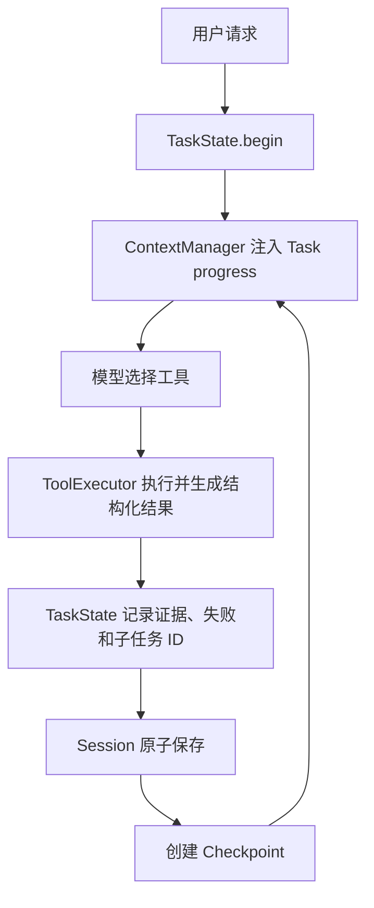

# HH Agent TaskState、任务恢复与交付门

## 1. 解决什么问题

`RunState` 只能回答“模型调用了几次、工具执行了几步、为什么停止”，不能回答：

- 当前目标是什么；
- 哪些子任务完成或失败；
- 已经获得什么证据；
- 哪些结论尚未验证；
- 程序中断后应该从哪里继续；
- 是否真的达到交付条件。

因此新增 Session 级 `TaskState`，并让它连接 ProjectTask、工具结果、Checkpoint、ContextManager 和 Agent Loop。

## 2. 各状态模块的边界

| 模块 | 生命周期 | 作用 |
| --- | --- | --- |
| `RunState` | 一次 `ask()` | 记录次数、最近工具、停止原因 |
| `TaskState` | 一个用户任务，可跨多个 Run | 记录目标、子任务、证据、结论、问题和下一步 |
| `ProjectTask` | 仓库级持久化 | 保存可认领、可依赖的显式子任务 |
| `Session` | 一段会话 | 保存 history、memory、TaskState 和 Checkpoint |
| `Checkpoint` | 任务过程中的恢复书签 | 保存 TaskState 的关键摘要和文件新鲜度 |
| `Trace` | 一次 Run 的审计事件流 | 用于复盘，不直接充当任务状态 |

## 3. TaskState 保存在哪里

TaskState 位于：

```text
.hh/sessions/<session_id>.json
```

核心结构：

```json
{
  "task_state": {
    "task_id": "taskrun_ab12cd34ef",
    "goal": "修复登录测试",
    "status": "running",
    "run_ids": ["run_..."],
    "subtask_ids": ["task_..."],
    "evidence": [],
    "claims": [],
    "open_questions": [],
    "failures": [],
    "next_action": "运行登录测试"
  }
}
```

列表都有上限，避免长任务无限放大 Session。

## 4. 子任务系统

ProjectTask 文件位于：

```text
.hh/tasks/task_<id>.json
```

支持状态：

```text
pending -> in_progress -> completed
                       -> failed
pending/in_progress    -> blocked
                       -> cancelled
```

新增字段：

- `acceptance_criteria`：完成条件；
- `evidence`：证明条件成立的证据；
- `failure_reason`：失败或阻塞原因；
- `updated_at`：最后更新时间。

相关工具：

| 工具 | 用途 |
| --- | --- |
| `create_task` | 创建子任务、依赖和验收条件 |
| `claim_task` | 从 pending 进入 in_progress |
| `complete_task` | 携带证据完成任务 |
| `fail_task` | 记录失败和原因 |
| `block_task` | 记录外部阻塞条件 |
| `record_evidence` | 记录已验证或未验证结论 |
| `list_tasks` | 查看持久化任务看板 |

如果任务有两个验收条件，却只记录一条证据，`complete_task` 会返回结构化错误，不能把任务标成 completed。

## 5. 证据和结论

每次工具执行都会自动加入 TaskState evidence：

```json
{
  "kind": "tool",
  "tool": "run_shell",
  "status": "ok",
  "error_code": "",
  "summary": "exit_code: 0 ...",
  "affected_paths": [],
  "created_at": "..."
}
```

重要结论可以显式记录：

```xml
<tool>{"name":"record_evidence","args":{
  "claim":"登录测试通过",
  "evidence":"pytest tests/test_login.py: 8 passed",
  "verified":true
}}</tool>
```

如果 `verified:false`，该结论会进入交付阻塞列表。取得新证据后，用相同 claim 再记录 `verified:true`，旧结论会升级为已验证，而不是永久残留一条未验证记录。

## 6. 每轮如何更新



TaskState 渲染进每轮请求末尾的 `<system-reminder>`，因此模型每轮都能看到目标、子任务、todo、未解决失败、未验证结论、开放问题，以及"改了代码是否已跑过测试"。

> 2026-10-30：**"改了代码但没跑通测试"不再阻止交付**，只在提醒里显示 `Code verification: pending test`。
> 原因：识别测试命令靠正则，复现脚本、仓库自定义命令、`cd … && pytest` 等合法验证会被误判（SWE-bench 冒烟实测误报）；
> 硬门禁还会逼模型自己写测试文件来过关。可重试的工具失败、未完成子任务、未验证结论、后台任务仍是阻塞项。

## 7. 中断与恢复

等待用户或到达步数上限时，TaskState 分别进入：

```text
waiting_for_user
paused
```

启动恢复：

```powershell
python -m hh_agent_pro --resume latest
```

恢复流程：

1. SessionStore 读取同一 Session JSON。
2. `CodingAgent.from_session()` 重建 Memory、TaskState 和 ProjectTaskStore。
3. Checkpoint 检查关键文件 hash、工作区、模型和工具签名。
4. 新的 Run ID 加入同一个 TaskState。
5. 用户补充信息作为 `user_followup` 证据保存。
6. ContextManager 将 Task progress 和 Checkpoint 放进新 prompt。

这不是恢复 Python 调用栈，而是根据持久化事实重新决策。

## 8. 交付门

模型返回 `<final>` 时，Agent Loop 调用 `delivery_blockers()`。存在以下任一情况就拒绝交付并写入 `completion_deferred` trace：

1. 显式子任务仍为 `pending` 或 `in_progress`；
2. 子任务为 `failed` 或 `blocked`；
3. 存在 `verified:false` 的结论；
4. 仍有开放问题；
5. 可恢复工具失败尚未处理；
6. 后台任务仍在运行。

模型必须继续处理，或者明确返回：

```xml
<needs_user_input>需要用户补充的信息</needs_user_input>
```

```xml
<blocked>无法继续的原因和下一步</blocked>
```

只有阻塞列表为空时，`<final>` 才会令 TaskState 进入 `completed`。

## 9. Checkpoint 的增强

Checkpoint 现在额外保存：

- `task_state_id` 和 `task_status`；
- 已完成子任务；
- 已验证结论；
- 开放问题；
- 最近证据；
- 语义化 blocker 和 next step。

因此恢复 prompt 不再只有“最后调用了 read_file”，而能表达“测试子任务尚未完成，因为目标路径缺失”。

## 10. 测试结果

- 全量 pytest：118/118 通过；
- deterministic Harness：14/14 通过；
- 外部 artifact verifier：14/14 通过。

新增测试覆盖：

- 有验收条件但没有证据时拒绝完成；
- `failed` 和 `blocked` 状态持久化；
- 子任务未完成时拒绝提前 `<final>`；
- 未验证结论阻止交付，补充证据后解除；
- 创建新 HH 对象恢复 Session 后继续同一子任务；
- 恢复后的 TaskState 保持相同 task ID，并记录多个 Run ID。

## 11. 当前边界

这个机制只检查 Runtime 能确定的事实，不会假装自动理解所有业务验收条件：

- 简单任务不强制创建子任务；
- 多步任务是否合理拆解仍受模型能力影响；
- evidence 是结构化证据记录，不等于形式化证明；
- 目前没有自动从用户自然语言中生成验收条件；
- 后台线程本身不能跨进程恢复，只能恢复已经落盘的结果。

这套设计的价值是让 Agent 从“依靠聊天记录猜进度”，升级为“有持久化进度、有证据、有明确阻塞条件的执行系统”。
