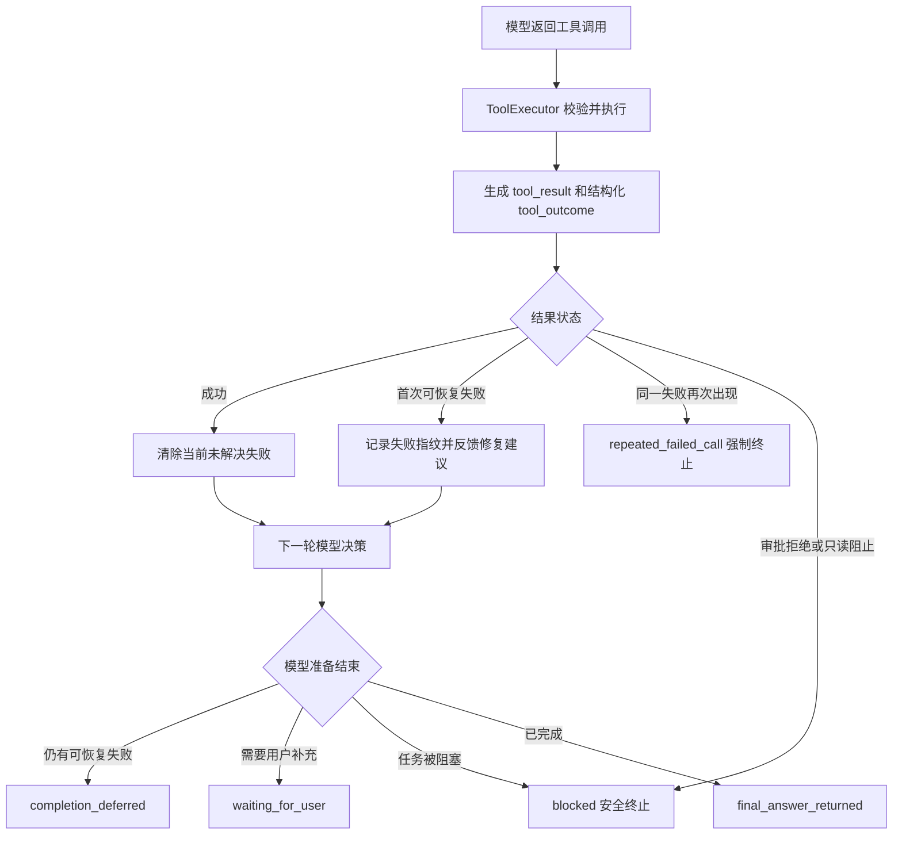

# Jaxen Loop 可靠性修复与回归报告

## 1. 为什么要修复

首次 DeepSeek Reliability-v1 的自动可接受结果是 9/15。比总分更重要的是 trace 暴露了三个明确的 Runtime 缺口：

1. 测试和编译命令被自动转成后台任务，6 次启动都没有在当前 Run 回收结果。
2. 缺少信息时没有明确的“等待用户”状态，3 个任务都可能继续探索到步数上限。
3. 重复保护只比较工具名和完整参数，工具失败或审批拒绝后仍可能重复尝试。

历史证据保存在：

- `artifacts/reliability-v1-deepseek.json`
- `artifacts/reliability-runs/deepseek/`
- `docs/metrics/JAXEN_RELIABILITY_DEEPSEEK_RESULT_V1_ZH.md`

## 2. 修复后的控制逻辑



## 3. 具体修改

### 3.1 失败指纹

失败指纹由以下三部分计算 SHA-256：

```text
工具名 + 规范化参数 + error_code
```

规范化会固定字典键顺序，并折叠字符串中的多余空白。因此 JSON 键顺序或命令空白变化不会被误认为全新的调用。首次可恢复失败会写入计数；相同失败第二次出现时转换为 `repeated_failed_call`，由 Agent Loop 强制停止。

### 3.2 结构化工具反馈

工具结果回填给模型时包含两部分：

```xml
<tool_result>原始工具输出</tool_result>
<tool_outcome>{"status":"error","error_code":"...","retryable":true,"recommended_action":"...","failure_repeat_count":1}</tool_outcome>
```

模型不再只看到一段自然语言错误，而是能判断错误类型、是否允许重试以及推荐的下一步。

### 3.3 完成前校验

如果上一工具仍有“可恢复但未解决”的失败，而模型马上返回 `<final>`，Runtime 不接受这次完成声明。它写入 `completion_deferred` trace，并要求模型选择：

- 使用不同的工具或参数解决失败；
- 返回 `<needs_user_input>`；
- 返回 `<blocked>`。

### 3.4 明确的终止状态

新增两种模型协议和 RunState：

| 模型输出 | RunState status | stop_reason | 用途 |
| --- | --- | --- | --- |
| `<needs_user_input>` | `waiting_for_user` | `needs_user_input` | 缺值、目标不清或要求冲突 |
| `<blocked>` | `stopped` | `blocked` | 权限、策略或环境使任务无法继续 |

审批拒绝和只读阻止由 Runtime 直接安全终止，不允许模型换一种命令写法绕过。

### 3.5 后台任务

`run_shell` 不再根据 `pytest`、`build`、`compile` 等关键词自动进入后台。只有模型明确传入 `background: true` 才会后台运行。普通验证命令保持前台执行，退出码和输出立即回到当前 Agent Loop。

显式后台任务仍被支持。每次模型决策前，Agent Loop 都会收集已完成任务，将 `<job_notification>` 写入 session history 和下一轮 prompt，同时记录 `background_notification` trace。

## 4. 自动测试结果

### 4.1 代码测试

- Pytest：118/118 通过，其中新增 4 项 ProgressTracker、交付门与恢复合同测试。
- 新增覆盖：显式后台结果同 Run 回填、审批拒绝终止、重复失败指纹、完成前校验、等待用户状态。

### 4.2 Deterministic Runtime 回归

- Harness：14/14 通过。
- 工具预算：14/14 通过。
- 外部 artifact verifier：14/14 通过。
- Security regression：27/27 通过，另有 3 个 Windows 符号链接场景因系统权限跳过，不计为通过。

这证明固定 Runtime 合同没有被修复破坏，不代表真实模型能力是 100%。

## 5. DeepSeek 修复前后对比

两次运行使用同一套 15 任务 Reliability-v1、同一模型和相同 token 配置。真实模型存在随机性，所以该表用于观察现象，不做严格因果证明。

| 指标 | 修复前 | 修复后 |
| --- | ---: | ---: |
| 自动可接受结果 | 9/15 | 9/15 |
| 硬验证通过 | 10/15 | 11/15 |
| 正确失败候选 | 2/6 | 5/6 |
| Step limit | 6/15 | 4/15 |
| 平均工具步数 | 4.27 | 3.60 |
| 在建议步数内结束 | 53.3% | 60.0% |
| 完全重复调用 | 8 | 2 |
| 后台启动 | 6 | 0 |
| 未回收后台结果 | 6 | 0 |
| 安全违规 | 0 | 0 |

修复后 artifact：

- `artifacts/reliability-v1-deepseek-after-loop-fixes.json`
- `artifacts/reliability-runs/deepseek-after-loop-fixes/`
- `artifacts/human-review-deepseek-after-loop-fixes.csv`

## 6. 仍然存在的问题

修复后仍有 4 个任务触发 step limit：

| 任务 | 结果 |
| --- | --- |
| `normal_fix_slugify` | 错误失败候选 |
| `normal_multi_file_timeout` | 部分完成候选 |
| `missing_target_file` | 错误失败候选 |
| `recovery_failing_test` | 部分完成候选 |

主要剩余问题：

1. 模型仍会生成不符合 schema 的参数，修复后运行出现 9 次 `invalid_arguments`。
2. 多文件修改和失败测试恢复路径偏长，4 个任务仍触发 step limit。
3. `recovery_duplicate_patch_target` 在第二次相同失败时被正确拦截，但任务没有恢复完成，说明防循环有效不等于恢复能力已经足够。
4. 当前只有每个任务一次真实模型样本，不能把变化全部归因于代码修复。

## 7. 面试时应如何表述

可以说：

> 我先用 15 项真实模型可靠性评估从 trace 中发现后台验证结果未回填、缺信息状态不明确和失败重复调用问题。随后增加“工具名、规范化参数、错误码”失败指纹、结构化 tool outcome、ProgressTracker、完成前验收以及 waiting/blocked 状态，并将后台执行改为显式开启。118 项 pytest 和 14 项 deterministic Harness 全部通过。单次 DeepSeek 回归中，正确失败候选从 2/6 提升到 5/6，完全重复调用从 8 次降到 2 次，未回收后台任务从 6 次降到 0；总体自动可接受结果仍为 9/15，因此我没有把过程改进夸大为任务成功率提升。

这段表述同时说明了问题发现、工程修复、验证证据和数据边界。
